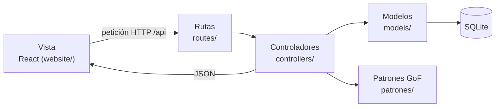

# Nailé · sitio web del salón de uñas

Sitio web con reservas en línea, galería de trabajos con buscador y filtros, diseñador de uñas, tienda y panel para el salón.

- **Frontend:** React + Vite (`website/`)
- **Backend:** Node.js + Express (`api/`)
- **Base de datos:** SQLite (`better-sqlite3`)
- **Fotos:** se suben desde el panel y se guardan en `uploads/`
- **Despliegue:** Railway (un solo servicio entrega la API, las fotos y el sitio)

## Qué tiene

| Página | Ruta | Qué hace |
|---|---|---|
| Inicio | `/` | Portada con foto destacada, servicios, trabajos recientes, pasos para reservar, horario y ubicación |
| Servicios | `/servicios` | Carta de servicios con precio y duración |
| Galería | `/galeria` | Fotos reales con buscador, filtros (servicio, forma, color, acabado), orden y visor a pantalla completa. Los filtros quedan en la URL, así se pueden compartir |
| Diseña tus uñas | `/disena` | Elige forma, largo, color, acabado y decoración, con muestra y recargo en vivo |
| Reservar | `/reservar` | Tres pasos: servicio y especialista, fecha y hora libres, datos y adelanto (SINPE Móvil, tarjeta o en el salón) |
| Tienda | `/tienda` | Productos con buscador, filtros por categoría y precio, orden y carrito |
| Contacto | `/contacto` | Datos, horario, mapa y mensaje directo por WhatsApp |
| Panel | `/admin` | Agenda del día, subir y editar fotos, fotos de productos y pedidos |

## Personalizar para el salón

1. **Datos del local:** `website/src/config.js` (nombre, teléfono, WhatsApp, dirección, horario, redes, SINPE y mapa).
2. **Logo:** el logo actual es provisional. Pon el archivo real en `website/public/logo.svg` (o `.png`) y cambia `website/src/components/Logo.jsx` por ``. Cambia también `website/public/favicon.svg`.
3. **Servicios, especialistas y productos:** `api/src/db/seed.js`. Los precios están en colones y son de ejemplo.
4. **Recargos por diseño:** la tabla `PRECIO` en `api/src/patrones/constructorDiseno.js` y en `website/src/patrones/constructorDiseno.js` (deben coincidir).
5. **Fotos de muestra:** la galería arranca con 16 fotos gratuitas de Unsplash (`api/src/db/fotosMuestra.js`), enlazadas con el crédito de cada fotógrafa. Se cargan solas si la galería está vacía. Cuando el salón tenga sus fotos, bórrenlas desde el panel.
6. **Datos de ejemplo:** al arrancar se crean unas 200 citas y 50 pedidos de clientas ficticias (`api/src/db/datosEjemplo.js`) para que la demo se vea real. Antes de usarlo con el salón de verdad, bórrenlos con `npm run limpiar` dentro de `api/`.
7. **Fotos:** entra a `/admin`, pestaña Galería, y sube las fotos de los trabajos con su servicio, forma, color y acabado. Así funcionan los filtros. Marca como destacada la que quieras en la portada.

## Contraseña del panel del salón (/admin)

- **La primera vez** la contraseña es `cambia-esta-clave` (o la que pongan en la variable `ADMIN_TOKEN` de Railway).
- **Para cambiarla:** entren a `/admin` → pestaña **Contraseña** → escriban la actual y la nueva dos veces. Mientras usen la inicial, el panel muestra un aviso para cambiarla.
- La contraseña se guarda **cifrada** (scrypt con sal) en la base de datos; nunca en texto. Al cambiarla se cierran las demás sesiones abiertas.
- Después de 5 intentos fallidos hay que esperar 5 minutos.

## Más fotos para la galería

- **~200 fotos gratuitas de Unsplash:** creen una cuenta en https://unsplash.com/developers, hagan una «New Application» y copien el *Access Key*. Dentro de `api/`:
  - PowerShell: `$env:UNSPLASH_KEY="su_access_key"; npm run fotos -- 200`
  - Mac/Linux: `UNSPLASH_KEY=su_access_key npm run fotos -- 200`
  - Usa 40 búsquedas distintas (manicure, pedicure, francesa, chrome, coffin, navidad…). Si se corta por el límite de 50 consultas por hora, se vuelve a correr una hora después y sigue donde quedó.

  Cada foto queda clasificada (servicio, forma, color, acabado) y con el crédito de su fotógrafa. Unsplash permite 50 consultas por hora, suficiente para unas 200 fotos.
- **Fotos del salón:** pongan las fotos en una carpeta con nombres descriptivos («francesa rosa almendra.jpg») y corran `npm run importar -- "ruta/de/la/carpeta"`.

## Servicios, combos y cupones

La carta tiene unos 30 servicios en 8 categorías (manos, uñas acrílicas, gel y polygel, pies, tratamientos, diseños y extras, retiros y combos) en `api/src/db/catalogoServicios.js`, cada uno con descripción, qué incluye, foto, duración, precio y, si aplica, precio de oferta y etiqueta (Más pedido, Nuevo, Oferta, Especial).

Los cupones (`BIENVENIDA15`, `COMBO5000`, `NAVIDAD20`, `AMIGA10` y uno privado `CUMPLE25`) están en el mismo archivo y en la tabla `cupones`. Se validan en el servidor (vigencia, compra mínima, solo combos) y el descuento se calcula con el patrón Decorator.

## Tienda

Unos 450 productos en 13 categorías (`api/src/db/catalogoProductos.js`): geles, rubber base, top coats, polygel, acrílico, lámparas, tornos, cortacutículas, limas, removedores, decoración y estampado, tips y press-on, cuidado de manos, pedicure, manicure profesional (estación de trabajo) y kits. Al subir la versión del catálogo, las bases de datos existentes reciben solo los productos nuevos. Para ponerles **fotos reales** de Unsplash (lámparas, cortacutículas, limas, cremas, frascos del color del esmalte…), dentro de `api/`:

- PowerShell: `$env:UNSPLASH_KEY="su_access_key"; npm run fotos-productos`
- Para reemplazar también las que ya tienen foto: `npm run fotos-productos -- --todas`

Usa unas 35 consultas (el límite es 50 por hora). Si se corta, esperen una hora y córranlo de nuevo: sigue con los que faltan. Cada foto muestra el crédito de su fotógrafa. Los productos sin foto muestran una ilustración, y siempre pueden subir la foto real del producto desde /admin → Productos.

## Fotos de la galería con descripción en español

Al prender el servidor, cada foto recibe (una sola vez) una descripción y etiquetas en español: colores, forma, largo, técnica (francesa, ombré, mármol…), piedras y decoraciones (perlas, cristales, flores 3D, charms…) y ocasión. Así el diseñador encuentra más fotos parecidas. Para repetirlo a mano: `npm run describir-fotos`.

Para traer fotos de decoraciones desde Unsplash (perlas, cristales, flores 3D, moños, aura, ojo de gato, cromo, foil…):

- PowerShell: `$env:UNSPLASH_KEY="su_access_key"; npm run fotos -- 150 --decoraciones`

## Reglas del salón

- **Ubicación y contacto:** Limón, Limón, Costa Rica · teléfono y WhatsApp **8532 6297** (`website/src/config.js`). El WhatsApp del salón está en el pie de página de todas las páginas y en Ayuda y contacto.
- **Cancelar:** las clientas y las especialistas solo pueden cancelar **hasta 2 horas antes** de la cita. La dueña puede cancelar siempre (emergencias).
- **Clienta que no llegó:** en la Agenda (dueña) o en el portal (especialista) aparece el botón **«No llegó»** cuando ya pasó la hora. Se elige **Reprogramar** (otra fecha, sin costo, se guarda el adelanto) o **Cobrar** (el adelanto, la mitad, el total u otro monto). Queda anotado quién decidió y se prepara el mensaje de WhatsApp para la clienta.
- **Comisión:** las especialistas ganan el **65 %** de lo que atienden y el 35 % queda para el salón (se puede cambiar por especialista en Equipo → Ajustes).
- **Datos de muestra:** las citas de muestra que ya pasaron se marcan solas como atendidas cada 15 minutos, para que la agenda, el cierre y las gráficas se vean como en un salón funcionando. Las citas reales nunca se tocan. `npm run limpiar` borra todo lo de muestra.

## Pestañas del panel (/admin)

| Pestaña | Para qué sirve |
|---|---|
| Agenda | Calendario del mes, citas del día, cancelar por emergencia y avisar por WhatsApp |
| **Servicios** | Ver, agregar y modificar servicios: precio, oferta, duración, categoría, qué incluye, foto, ocultar o eliminar |
| Galería | Botón **«+ Agregar nueva imagen»**. Cada diseño puede tener su propio precio (cualquier monto); si se deja vacío usa el precio del servicio |
| Productos | Productos de la tienda. Arriba, **«Fotos de los círculos de categorías»**: cambiar la foto de cada círculo, **ocultar** un círculo, o **agregar** al Inicio el círculo de una categoría de la tienda. Para una categoría nueva se crea un producto con ese nombre de categoría |
| Equipo | Cada especialista tiene un botón **«Abrir ficha»** con 4 partes: 1) datos, foto y horario, 2) pago y estación, 3) días libres, 4) usuario y contraseña del portal |
| **Pagos al equipo** | Quincena por quincena: citas atendidas, lo vendido, comisión, total a pagar, días trabajados, libres y ausencias. Marcar como pagado y descargar en Excel |
| Pedidos | Pedidos de la tienda con filtros y Excel |
| **Cierre del día** | Reporte de fin de día: ingresos, pago al equipo, ganancia del salón, pérdidas y la lista de citas perdidas. Se imprime o se manda por WhatsApp. Después de las 5 p. m. el panel avisa que ya se puede ver |
| **Gráficas** | Ventas por día o por mes, citas por especialista, servicios y productos más vendidos, formas de pago y cómo terminaron las citas. Cada gráfica se descarga como imagen (PNG) o para Excel (CSV) |
| Contraseña | Cambiar la contraseña del panel |

## Portal del equipo (/equipo)

1. En el panel: **Equipo** → «Pago, días libres y acceso» → **Usuario y contraseña** → escriban un usuario y una contraseña (o toquen «Inventar una contraseña segura») → **Dar acceso**.
2. Denle el usuario y la contraseña a la especialista en persona.
3. Ella entra en **Acceso del equipo** (al pie de la página o en `/equipo`) y ve: sus citas de los próximos 14 días con el nombre, teléfono, servicio, diseño y notas de cada clienta (con botón de WhatsApp), sus clientas, su estación, su horario, sus días libres y lo que lleva ganado en la quincena. No ve nada de las demás.
- La contraseña se guarda cifrada (scrypt). 5 intentos fallidos = esperar 5 minutos. Al cambiarla se cierran sus sesiones.
- **Días de pago:** el 15 y el último día de cada mes (si cae domingo, el sábado antes). Solo cuentan las citas marcadas como atendidas. Si quedan citas de días pasados sin marcar, «Pagos al equipo» avisa y tiene un botón para marcarlas todas.
- Un día marcado como libre/vacaciones ya no se puede reservar con esa especialista.
- **Pedir días libres:** en el portal, pestaña «Días libres» → «Pedir un día libre». La solicitud aparece en la **campanita de avisos** del panel (arriba a la derecha, con un número rojo) para **Aprobar** o **No aprobar**; si se aprueba, ese día ya no se puede reservar con ella.
- **Fotos de las clientas:** se usa la foto de su cuenta (por ejemplo, la de Google). Las clientas de ejemplo reciben fotos de Unsplash con `npm run fotos-clientas` (con la clave `UNSPLASH_KEY`, igual que los otros comandos de fotos). Si una clienta no tiene foto, se muestran sus iniciales.
- **Cancelar una cita desde el portal:** la especialista toca «Cancelar cita», elige el motivo y si le ofrece otro día. La cita se cancela (patrón State), el aviso para la clienta queda escrito (Template Method) y se abre en WhatsApp para enviarlo. La administradora la ve cancelada en la Agenda con el nombre de quien la canceló.

## Ver la base de datos (solo para quien programa)

- **Desde VS Code:** instalen la extensión **SQLite Viewer** y abran `api/naile.db`.

## Correr en local

Necesitas Node.js 20 o superior.

```bash
cd api
npm install
npm run dev          # API en http://localhost:3001

# en otra terminal
cd website
npm install
npm run dev          # sitio en http://localhost:5173
```

La clave del panel en desarrollo es `cambia-esta-clave`. Para cambiarla, define la variable `ADMIN_TOKEN`.

## Desplegar en Railway

1. Sube el proyecto a GitHub.
2. En Railway: **New Project → Deploy from GitHub repo**.
3. En **Settings** del servicio: Build Command `npm run build`, Start Command `npm start`.
4. Agrega un **Volume** montado en `/data`. Ahí viven la base de datos y las fotos; sin el volumen se borran en cada despliegue.
5. En **Variables**:
   - `DB_PATH=/data/naile.db`
   - `UPLOADS_DIR=/data/uploads`
   - `ADMIN_TOKEN=` una clave larga que solo conozca el salón
   - `NODE_ENV=production`
   - `TZ=America/Costa_Rica` (para que las fechas, el cierre del día y las citas usen la hora de Costa Rica)
   - `COSTO_ENVIO=2500` (opcional: precio del envío a domicilio)
   - `GOOGLE_CLIENT_ID=` y `FACEBOOK_APP_ID=` + `FACEBOOK_APP_SECRET=` para entrar con Google y Facebook (ver abajo)
6. **Networking → Generate Domain** para la URL pública. Si el salón tiene dominio propio, se conecta en **Custom Domain**.

## Cuentas de clientas (Google, Facebook y formulario)

Para comprar hay que tener cuenta. Con correo y contraseña funciona sin configurar nada (las contraseñas se guardan con scrypt).
Los botones de Google y Facebook se activan solos cuando existen sus variables:

- **Google:** en https://console.cloud.google.com → *APIs y servicios → Credenciales → Crear ID de cliente de OAuth* (tipo *Aplicación web*).
  En *Orígenes de JavaScript autorizados* pongan `http://localhost:5173` y la URL de Railway. Copien el ID en `GOOGLE_CLIENT_ID`.
- **Facebook:** en https://developers.facebook.com → *Crear app* → producto *Inicio de sesión con Facebook*.
  Agreguen el dominio de Railway, y copien *Identificador de la app* en `FACEBOOK_APP_ID` y la *Clave secreta* en `FACEBOOK_APP_SECRET`.

Ninguna de estas claves va en el código ni en GitHub: solo en las variables.

## Arquitectura MVC

El proyecto sigue el patrón **Modelo, Vista, Controlador**:

| Capa | Dónde | Responsabilidad |
|---|---|---|
| **Modelo** | `api/src/models/` | Datos y reglas de negocio. Es la única capa que habla con SQLite (por ejemplo, `CitaModel` valida datos, calcula el total y el adelanto y consulta horarios libres). |
| **Vista** | `website/` (React) | Lo que ve la clienta y el salón. No conoce la base de datos: pide todo a la API. |
| **Controlador** | `api/src/controllers/` | Recibe cada petición, pide datos a los modelos, aplica los patrones (cobro, estados, eventos) y responde. |
| Rutas | `api/src/routes/` | Solo conectan cada URL con su controlador, sin lógica. |



Ejemplo, reservar una cita:

1. **Vista:** `website/src/pages/Reservar.jsx` envía `POST /api/citas`.
2. **Ruta:** `routes/publicRoutes.js` la manda a `citaController.crear`.
3. **Controlador:** `controllers/citaController.js` valida con `CitaModel`, cobra con la estrategia de pago (Strategy + Factory), guarda la cita y emite el evento `cita:creada` (Observer).
4. **Modelo:** `models/CitaModel.js` guarda en SQLite; `models/RecordatorioModel.js` guarda los recordatorios.
5. La vista recibe el JSON y muestra la confirmación.

### Estructura del backend

```
api/src/
  index.js        arranque del servidor
  db/             conexion.js (Singleton), schema.sql, datos de ejemplo y comandos de fotos
  models/         Modelo: una clase por tabla (Producto, Cita, Pedido, Usuario, Admin…)
  controllers/    Controlador: recibe cada petición y responde (catálogo, citas, pedidos, cuentas, panel…)
  routes/         publicRoutes.js (sitio), adminRoutes.js (panel), equipoRoutes.js (portal del equipo) e index.js
  patrones/       Patrones de diseño GoF (ver la tabla de abajo)
  middleware/     sesión del panel, del equipo y de clientas, y subida de imágenes

website/src/
  main.jsx, App.jsx   arranque y rutas de las páginas
  pages/              Vista: una página por archivo (Tienda, Galería, Reservar…); pages/admin/ es el panel
  components/         piezas reutilizables (tarjetas, encabezado, chat, accesibilidad…)
  context/            datos compartidos entre páginas: carrito, favoritos, cuenta, reserva (Observer)
  patrones/           cadenaAsistente.js (Chain of Responsibility) y constructorDiseno.js (Builder)
  lib/                ayudas: conexión con la API, esmaltes, fichas de producto
  estilos/            todos los CSS, uno por parte del sitio; index.css los carga en orden
```

## Patrones de diseño (GoF)

El proyecto usa **12 usos de patrones GoF** (10 patrones distintos). La explicación completa, con GRASP y SOLID, está en [`DOCUMENTACION.md`](DOCUMENTACION.md). Cada uno está en un archivo con el nombre del patrón:

| # | Patrón | Archivo | Para qué se usa |
|---|---|---|---|
| 1 | **Singleton** | `api/src/db/conexion.js` | Toda la aplicación comparte una sola conexión a la base de datos. |
| 2 | **Strategy** | `api/src/patrones/estrategiaPagos.js` | SINPE Móvil, tarjeta o pago en el salón se cobran con el mismo método `cobrar()`. |
| 3 | **Strategy** | `api/src/patrones/estrategiaAutenticacion.js` | Entrar con formulario, Google o Facebook usa el mismo método `autenticar()`. |
| 4 | **Factory Method** | `crearMetodoPago()`, `crearEstrategia()`, `crearMensaje()` | El controlador pide «sinpe», «google» o «cancelacion» y la fábrica entrega la clase correcta. |
| 5 | **Decorator** | `api/src/patrones/decoradorPrecio.js` | El precio se arma por capas: servicio → recargo del diseño → cupón (porcentaje o monto). |
| 6 | **Builder** | `api/src/patrones/constructorDiseno.js` y `website/src/patrones/constructorDiseno.js` | El diseño de uñas se arma paso a paso (forma, largo, colores por uña…) y calcula su precio. |
| 7 | **State** | `api/src/patrones/estadoCita.js` y `estadoPedido.js` | Una cita o un pedido solo puede pasar a los estados permitidos (por ejemplo, no se completa algo cancelado). |
| 8 | **Observer** | `api/src/patrones/observadorEventos.js` y `website/src/context/` | Al crear o cancelar una cita se programan o borran los recordatorios; el carrito, favoritos y la cuenta avisan a todas las pantallas cuando cambian. |
| 9 | **Template Method** + **Adapter** | `api/src/patrones/plantillaMensajes.js` | Todos los mensajes de WhatsApp siguen la misma plantilla (saludo, motivo, detalle, despedida); el adaptador convierte el teléfono de Costa Rica en un enlace de WhatsApp. |
| 10 | **Chain of Responsibility** | `website/src/patrones/cadenaAsistente.js` | Cada tema del chat (precios, horario, pagos…) revisa la pregunta; si no es suya, la pasa al siguiente. |
| 11 | **Strategy (pago del equipo)** | `api/src/patrones/estrategiaComision.js` | «Comisión» y «Base + comisión» calculan el pago con el mismo método `calcular()`; `crearEsquemaPago()` (Factory) elige cuál usar según la especialista. |
| 12 | **Strategy (cita perdida)** | `api/src/patrones/estrategiaInasistencia.js` | Cuando una clienta no llega, la dueña o la especialista elige «Reprogramar» o «Cobrar»; las dos usan el mismo método `aplicar()`. |

## Accesibilidad

- Navegación completa con teclado, foco visible y enlace «Saltar al contenido».
- Filtros, opciones y horarios hechos con casillas y radios reales, que los lectores de pantalla entienden.
- Textos con contraste AA; las fotos usan su descripción como texto alternativo.
- Visor de fotos y carrito con `<dialog>`: Esc cierra y el foco queda dentro.
- Respeta «reducir movimiento» del sistema.

## Pendiente para producción

- Usuarios del panel con contraseña (bcrypt + JWT) en lugar de una sola clave.
- Pasarela de pago real del banco y envío real de recordatorios (WhatsApp Business o correo) leyendo la tabla `recordatorios`.
- Comprimir las fotos al subirlas (por ejemplo con `sharp`).


## Reseñas y productos agotados

- Cada producto tiene reseñas (`resenas`, MVC: `ResenaModel` → `resenaController` → `GET/POST /api/productos/:id/resenas`). Una clienta puede escribir la suya; si pone su número de pedido y teléfono, sale como **compra verificada**.
- Las reseñas que trae la base de datos son **de ejemplo** (columna `ejemplo = 1`) para la demo del curso. **Antes de abrir la tienda al público, bórrenlas con `npm run limpiar`** (dentro de `api/`): las reseñas que se muestran deben ser de clientas reales.
- Algunos productos están agotados (stock 0): se ven en gris, la página ofrece "Ver similares" y "Avisarme por WhatsApp", y en el carrito pasan a "Artículos no disponibles".
- El banner del inicio cambia según el mes (`campanaActual()` en `website/src/config.js`).

## Finalizar compra

- `/finalizar-compra`: datos para el retiro, artículos, mensaje de regalo, métodos de pago (SINPE Móvil, tarjeta o pago en el salón), cupón y resumen del pedido.
- El resumen lo calcula el servidor (`POST /api/pedidos/cotizar`) con los precios de la base de datos y el cupón (patrón Decorator: `PrecioPedido` + `CuponPorcentaje`/`CuponMonto`). Los métodos de pago siguen usando Strategy + Factory.
- **La tarjeta está en modo de prueba**: se valida (Luhn y vencimiento), no se cobra nada y solo se guarda la marca y los últimos 4 dígitos. El CVV nunca sale del navegador. Para cobrar de verdad hay que conectar una pasarela de pago de un banco o proveedor en `PagoTarjeta.cobrar()`. Número de prueba: 4242 4242 4242 4242.

## Especialistas y citas en el carrito

- 10 especialistas de ejemplo (`api/src/db/especialistasEjemplo.js`), cada una con especialidad, días y horas de trabajo. La disponibilidad respeta ese horario (`CitaModel.disponibilidad`), y `GET /api/especialistas/:id/agenda` da los próximos espacios libres para su ficha.
- Fotos: `$env:UNSPLASH_KEY="..."; npm run fotos-especialistas` pone fotos de muestra. **Para el sitio real usen fotos del equipo de verdad** (las clientas deben ver a quien las atiende).
- Flujo de una cita: Galería → «Reservar este diseño» → servicio, especialista, fecha y hora → «¿Vas con alguien más?» (otra cita aparte, con la misma especialista en la hora siguiente o con otra a la misma hora) → **carrito** → Finalizar compra.
- Reglas: cada cita es una persona con un solo diseño (cantidad fija en 1); el press-on es un set por diseño. En Finalizar compra se pagan juntos productos y citas: productos completos + 30 % de las citas; el resto en el salón. Todo se guarda en una transacción: si una hora se ocupa en ese momento, no se guarda nada.

## Probador de uñas (Diseña tus uñas)

- Usa una foto real de una mano (`website/public/img/mano.jpg`) a la que se le borraron las uñas; encima se dibuja cada uña en SVG con la forma, el largo, el esmalte, el acabado y la decoración. `mano-mascara.png` marca dónde está la piel para cambiar el tono.
- Si cambian la foto, hay que volver a medir la base, el ancho y el giro de cada uña en `website/src/components/ManoFoto.jsx`.
- 273 esmaltes con código (AH-001…) en `api/src/db/esmaltes.js` (copiado en `website/src/lib/esmaltes.js`). Ahí también están las opciones y los precios del diseño, que usan el diseñador y el servidor.
- Se puede diseñar uña por uña. Precio: el largo por juego; acabado, decoración y esmaltes especiales por dedo (en las dos manos); +₡500 por cada color extra combinado. El servidor recalcula el precio al guardar el diseño (patrón Builder).

## Regalos y cupones que aparecen solos

- **Ruleta:** ya no hay un botón fijo. La primera visita se abre sola; en otras visitas el regalo aparece unos segundos al entrar o al poner algo en el carrito (máximo dos veces por visita y nunca si giró en las últimas 12 horas).
- **Cupones:** ya no hay una lista a la vista. Aparecen como «¡Un regalo para ti!»: al poner un combo en el carrito (cupón de combos), cuando el carrito pasa el monto mínimo de un cupón, o un rato después de entrar. Máximo dos por visita y nunca el mismo en 3 días (`website/src/components/CuponSorpresa.jsx`).

## Buscador

Al escribir en el buscador del encabezado aparecen al instante servicios, productos y diseños (con la parte que coincide resaltada). Se puede usar con las flechas del teclado y Enter (`website/src/components/BuscadorEnVivo.jsx`).

## Campanita de avisos del panel

Arriba a la derecha del panel hay una campanita con un número. Al tocarla se ven, sin llenar la pantalla: los días libres que pidieron las especialistas (se aprueban desde ahí), los pedidos nuevos por preparar, las citas por confirmar y las citas de días pasados que falta marcar como atendidas.
