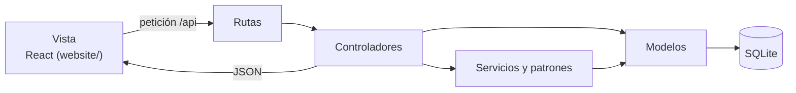

# AH Nails · Sitio web del salón de uñas

Sitio web completo para un salón de uñas: reservas en línea, galería de trabajos, diseñador de uñas, tienda, portal para el equipo y panel para la dueña.

**Autoras:** Hyldia Thomas y Alice Arias
**Curso:** Diseño de Software

---

## Contenido

1. [Tecnologías](#1-tecnologías)
2. [Páginas del sitio](#2-páginas-del-sitio)
3. [Reglas del salón](#3-reglas-del-salón)
4. [Panel de la dueña](#4-panel-de-la-dueña-admin)
5. [Portal del equipo](#5-portal-del-equipo-equipo)
6. [Compras, citas y pagos](#6-compras-citas-y-pagos)
7. [Diseña tus uñas](#7-diseña-tus-uñas)
8. [Fotos](#8-fotos)
9. [Datos de ejemplo](#9-datos-de-ejemplo)
10. [Correr en la computadora](#10-correr-en-la-computadora)
11. [Comandos útiles](#11-comandos-útiles)
12. [Publicar en Railway](#12-publicar-en-railway)
13. [Cuentas de clientas](#13-cuentas-de-clientas)
14. [Arquitectura MVC](#14-arquitectura-mvc)
15. [Patrones de diseño](#15-patrones-de-diseño-gof)
16. [Seguridad](#16-seguridad)
17. [Accesibilidad](#17-accesibilidad)
18. [Pendiente para producción](#18-pendiente-para-producción)

---

## 1. Tecnologías

| Parte                | Tecnología                                                     | Carpeta          |
| -------------------- | --------------------------------------------------------------- | ---------------- |
| Sitio (lo que se ve) | React + Vite                                                    | `website/`     |
| Servidor             | Node.js + Express                                               | `api/`         |
| Base de datos        | SQLite (`better-sqlite3`)                                     | `api/naile.db` |
| Fotos subidas        | Se guardan en el servidor                                       | `uploads/`     |
| Publicación         | Railway (un solo servicio entrega el sitio, la API y las fotos) | —               |

La explicación técnica completa (MVC, patrones GoF, GRASP y SOLID) está en [`DOCUMENTACION.md`](DOCUMENTACION.md).

---

## 2. Páginas del sitio

| Página             | Dirección            | Qué hace                                                                                                                               |
| ------------------- | --------------------- | --------------------------------------------------------------------------------------------------------------------------------------- |
| Inicio              | `/`                 | Portada, círculos de categorías, servicios, diseños destacados, tienda y reseñas                                                    |
| Servicios           | `/servicios`        | Unos 30 servicios en 8 categorías, con precio, duración, filtros y botón para reservar                                               |
| Galería            | `/galeria`          | Fotos reales con buscador, filtros (servicio, forma, color, acabado) y orden. Los filtros quedan en la dirección y se pueden compartir |
| Detalle de diseño  | `/galeria/:id`      | Foto grande, datos, diseños parecidos y «Reservar este diseño»                                                                      |
| Diseña tus uñas   | `/disena`           | Diseñador paso a paso sobre la foto de una mano, uña por uña, con precio en vivo                                                     |
| Reservar            | `/reservar`         | Servicio, especialista, día y hora libres, y pasa al carrito                                                                           |
| Tienda              | `/tienda`           | Unos 450 productos con filtros, orden, buscador y carrito                                                                               |
| Detalle de producto | `/tienda/:id`       | Fotos, precio, reseñas y productos parecidos                                                                                           |
| Carrito             | `/carrito`          | Productos y citas juntos                                                                                                                |
| Finalizar compra    | `/finalizar-compra` | Datos, método de pago, cupón y resumen                                                                                                |
| Mi cuenta           | `/cuenta`           | Pedidos, citas (cancelar hasta 2 horas antes) y direcciones                                                                             |
| Favoritos           | `/favoritos`        | Diseños y productos guardados con el corazón                                                                                          |
| Buscar              | `/buscar`           | Resultados de servicios, productos y diseños                                                                                           |
| Ayuda y contacto    | `/contacto`         | Datos del salón, horario, preguntas frecuentes y mensaje por WhatsApp                                                                  |
| Portal del equipo   | `/equipo`           | Entrada de las especialistas                                                                                                            |
| Panel               | `/admin`            | Panel de la dueña                                                                                                                      |

**El buscador del encabezado** muestra resultados mientras se escribe y se puede usar con las flechas y Enter.

---

## 3. Reglas del salón

| Regla                 | Cómo funciona                                                                                                                                                                                                                                                              |
| --------------------- | --------------------------------------------------------------------------------------------------------------------------------------------------------------------------------------------------------------------------------------------------------------------------- |
| Ubicación y contacto | Limón, Limón, Costa Rica · 8532 6297. El WhatsApp está en el pie de página y en Ayuda y contacto (`website/src/config.js`)                                                                                                                                           |
| Cancelar una cita     | Clientas y especialistas,**solo hasta 2 horas antes**. La dueña puede cancelar siempre (emergencias)                                                                                                                                                                 |
| Clienta que no llegó | Al pasar la hora aparece el botón**«No llegó»**. La dueña o la especialista elige**Reprogramar** (otra fecha, se guarda el adelanto) o **Cobrar** (adelanto, mitad, total u otro monto). Queda anotado quién decidió y se prepara el mensaje de WhatsApp |
| Comisión             | Cada especialista gana el**65 %** de lo que atiende; el 35 % queda para el salón. Se puede cambiar por especialista                                                                                                                                                  |
| Días de pago         | El 15 y el último día del mes. Si cae domingo, se paga el sábado anterior                                                                                                                                                                                                |
| Adelanto de citas     | Se paga el 30 % al reservar; el resto en el salón                                                                                                                                                                                                                          |
| Uña levantada        | Si pasa en los primeros 5 días, se arregla sin costo                                                                                                                                                                                                                       |

---

## 4. Panel de la dueña (`/admin`)

**Contraseña inicial:** `cambia-esta-clave` (o la que tenga la variable `ADMIN_TOKEN`). Mientras se use la inicial, el panel avisa que hay que cambiarla.

| Pestaña        | Para qué sirve                                                                                                                                                          |
| --------------- | ------------------------------------------------------------------------------------------------------------------------------------------------------------------------ |
| Agenda          | Calendario del mes, citas del día, «No llegó», cancelar por emergencia y avisar por WhatsApp                                                                         |
| Servicios       | Agregar, cambiar, ocultar o eliminar servicios (precio, oferta, duración, foto)                                                                                         |
| Galería        | «+ Agregar nueva imagen». Cada diseño puede tener su propio precio                                                                                                    |
| Productos       | Productos de la tienda. Arriba, las tarjetas de los**círculos de categorías**: cambiar la foto, ocultar un círculo o agregarlo al Inicio                        |
| Pedidos         | Pedidos de la tienda con filtros y descarga en Excel                                                                                                                     |
| Equipo          | Ficha de cada especialista: datos y horario, pago y estación, días libres, usuario y contraseña del portal                                                            |
| Pagos al equipo | Quincena por quincena: citas, ventas, comisión y total a pagar. Marcar como pagado y bajar en Excel                                                                     |
| Cierre del día | Ingresos, pago al equipo, ganancia del salón, pérdidas y citas perdidas. Se imprime o se manda por WhatsApp. Después de las 5 p. m. el panel avisa que ya está listo |
| Gráficas       | Ventas, citas por especialista, servicios y productos más vendidos, formas de pago. Cada gráfica se baja como imagen (PNG) o para Excel (CSV)                          |
| Contraseña     | Cambiar la contraseña del panel                                                                                                                                         |

**Campanita de avisos** (arriba a la derecha): días libres por aprobar, pedidos nuevos, citas por confirmar y citas pasadas sin marcar.

**Si se olvida la contraseña**, dentro de `api/`:

```bash
npm run cambiar-contrasena -- correo@ejemplo.com claveNueva
```

---

## 5. Portal del equipo (`/equipo`)

**Cómo darle acceso a una especialista**

1. En el panel: **Equipo** → abrir su ficha → **Usuario y contraseña**.
2. Escribir un usuario y una contraseña (o tocar «Inventar una contraseña segura») → **Dar acceso**.
3. Darle los datos en persona.

**Qué ve la especialista** (solo lo suyo, nunca lo de las demás):

- Sus citas de los próximos 14 días con nombre, teléfono, servicio, diseño y notas de cada clienta.
- Sus clientas, su estación, su horario y sus días libres.
- Lo que lleva ganado en la quincena.

**Qué puede hacer**

- **Cancelar una cita** (hasta 2 horas antes): elige el motivo y se abre el mensaje para la clienta en WhatsApp.
- **Marcar «No llegó»** y decidir si se reprograma o se cobra.
- **Pedir un día libre**: la solicitud le llega a la dueña en la campanita. Si se aprueba, ese día ya no se puede reservar con ella.

---

## 6. Compras, citas y pagos

- **Para comprar hay que tener cuenta** (correo y contraseña, o Google y Facebook si están configurados).
- **Flujo de una cita:** Galería → «Reservar este diseño» → servicio, especialista, día y hora → «¿Vas con alguien más?» → carrito → finalizar compra.
- Cada cita es para una persona con un solo diseño.
- En **Finalizar compra** se pagan juntos los productos completos y el 30 % de las citas.
- **El servidor calcula el resumen** (`POST /api/pedidos/cotizar`) con los precios de la base de datos y el cupón. Así nadie puede cambiar un precio desde el navegador.
- **Todo se guarda junto:** si una hora se ocupa en ese momento, no se guarda nada.
- **Métodos de pago:** SINPE Móvil, tarjeta o pago en el salón.
- **Tarjeta en modo de prueba:** se revisa el número (Luhn) y el vencimiento, pero no se cobra nada. Número de prueba: `4242 4242 4242 4242`.

**Cupones:** `BIENVENIDA15`, `COMBO5000`, `NAVIDAD20`, `AMIGA10` y uno privado, `CUMPLE25`. El servidor revisa la vigencia, la compra mínima y si es solo para combos.

**Regalos sorpresa:**

- **Ruleta:** se abre sola en la primera visita. Después aparece de vez en cuando, nunca si se giró en las últimas 12 horas.
- **Cupones sorpresa:** salen al agregar un combo o al pasar el monto mínimo. Máximo dos por visita y nunca el mismo en 3 días.

**Reseñas:** cada producto tiene reseñas. Si la clienta pone su número de pedido y su teléfono, sale como **compra verificada**.

**Productos agotados:** se ven en gris, con «Ver similares» y «Avisarme por WhatsApp».

---

## 7. Diseña tus uñas

- **Cómo se ve:** se usa una foto real de una mano sin uñas (`website/public/img/mano.jpg`). Encima se dibuja cada uña con su forma, largo, color, acabado y decoración. Con `mano-mascara.png` se cambia el tono de piel.
- **Uña por uña:** se puede cambiar las 5 uñas juntas o una sola. Tocar una uña cambia solo esa.
- **Decoraciones:** perlas, cristales, stickers, polvos, flores 3D, foil, charms y líneas finas, eligiendo en qué uña y en qué parte va cada una.
- **273 esmaltes** con código (AH-001…), en `api/src/db/esmaltes.js` y copiados en `website/src/lib/esmaltes.js`. Los dos archivos deben ser iguales.
- **Fotos parecidas:** debajo del diseño salen fotos reales parecidas. Cuentan más las decoraciones, después el color y al final la forma.

**Cómo se calcula el precio:**

| Parte                                   | Cómo se cobra                                         |
| --------------------------------------- | ------------------------------------------------------ |
| Largo                                   | Una vez por juego                                      |
| Acabado, decoración y esmalte especial | Por uña, por 2 (las dos manos)                        |
| Decoraciones pegadas                    | Precio por uña × uñas elegidas × 2 manos           |
| Colores combinados                      | +₡500 por cada color de más (el primero va incluido) |

Al guardar el diseño, el servidor vuelve a calcular el precio (patrón Builder).

Si se cambia la foto de la mano, hay que volver a medir cada uña en `website/src/components/ManoFoto.jsx`.

---

## 8. Fotos

Todas las fotos de muestra son **gratuitas de Unsplash** y muestran el nombre de su fotógrafa. No se usan fotos de Pinterest, con marca de agua ni de pago.

**Clave de Unsplash:**

1. Crear una cuenta en https://unsplash.com/developers.
2. Hacer una «New Application» y copiar el *Access Key*.
3. **La clave nunca va en el código ni en GitHub.** Se escribe solo en la terminal antes del comando (PowerShell):

```powershell
$env:UNSPLASH_KEY="su_access_key"
```

Unsplash permite 50 consultas por hora. Si un comando se corta, se vuelve a correr una hora después y sigue donde quedó.

| Para qué                                              | Comando (dentro de `api/`)                 |
| ------------------------------------------------------ | -------------------------------------------- |
| Unas 200 fotos para la galería                        | `npm run fotos -- 200`                     |
| Fotos de decoraciones (perlas, cristales, flores 3D…) | `npm run fotos -- 150 --decoraciones`      |
| Fotos de los productos                                 | `npm run fotos-productos`                  |
| Reemplazar también las que ya tienen foto             | `npm run fotos-productos -- --todas`       |
| Fotos de muestra de las especialistas                  | `npm run fotos-especialistas`              |
| Fotos de muestra de las clientas                       | `npm run fotos-clientas`                   |
| Importar fotos del salón desde una carpeta            | `npm run importar -- "ruta/de/la/carpeta"` |
| Volver a escribir las descripciones en español        | `npm run describir-fotos`                  |

- **Descripciones en español:** al prender el servidor, cada foto recibe una sola vez una descripción y etiquetas (colores, forma, técnica, decoraciones). Así el diseñador encuentra más fotos parecidas.
- **Nombres al importar:** las fotos del salón deben tener nombres descriptivos, por ejemplo «francesa rosa almendra.jpg».
- **Para el sitio real:** usen fotos del equipo de verdad. Las clientas deben ver a quien las va a atender.

---

## 9. Datos de ejemplo

Para que la demo se vea como un salón funcionando, la base de datos trae datos de muestra:

- 10 especialistas.
- Citas de los últimos 60 días y de los próximos días.
- Pedidos de la tienda.
- Reseñas y comentarios.

Las citas de muestra que ya pasaron se marcan solas como atendidas cada 15 minutos. **Las citas reales nunca se tocan.**

**Antes de abrir el sitio al público, borren todo lo de muestra.** Dentro de `api/`:

```bash
npm run limpiar
```

---

## 10. Correr en la computadora

Se necesita **Node.js 20 o superior**.

```bash
# Terminal 1: el servidor
cd api
npm install
npm run dev          # http://localhost:3001

# Terminal 2: el sitio
cd website
npm install
npm run dev          # http://localhost:5173
```

**Para ver la base de datos:** en VS Code, instalen la extensión **SQLite Viewer** y abran `api/naile.db`.

---

## 11. Comandos útiles

Todos se corren dentro de `api/`.

| Comando                                                | Qué hace                                           |
| ------------------------------------------------------ | --------------------------------------------------- |
| `npm run dev`                                        | Prende el servidor y lo reinicia al guardar cambios |
| `npm start`                                          | Prende el servidor                                  |
| `npm run seed`                                       | Carga los datos iniciales                           |
| `npm run limpiar`                                    | Borra todos los datos de muestra                    |
| `npm run cambiar-contrasena -- correo clave`         | Cambia la contraseña de una cuenta                 |
| `npm run fotos`, `fotos-productos`, `importar`… | Ver la[sección de fotos](#8-fotos)                    |

---

## 12. Publicar en Railway

1. **GitHub:** subir el proyecto a GitHub.
2. **Crear el proyecto:** en Railway, **New Project → Deploy from GitHub repo**.
3. **Settings:** Build Command `npm run build` y Start Command `npm start`.
4. **Volume:** agregar uno montado en `/data`. Ahí viven la base de datos y las fotos; sin él se borran en cada publicación.
5. **Variables:**

| Variable                                      | Valor                                                                                       |
| --------------------------------------------- | ------------------------------------------------------------------------------------------- |
| `DB_PATH`                                   | `/data/naile.db`                                                                          |
| `UPLOADS_DIR`                               | `/data/uploads`                                                                           |
| `ADMIN_TOKEN`                               | Una clave larga que solo conozca el salón                                                  |
| `NODE_ENV`                                  | `production`                                                                              |
| `TZ`                                        | `America/Costa_Rica` (para que el cierre del día y las citas usen la hora de Costa Rica) |
| `COSTO_ENVIO`                               | Opcional: precio del envío a domicilio, por ejemplo `2500`                               |
| `GOOGLE_CLIENT_ID`                          | Opcional: para entrar con Google                                                            |
| `FACEBOOK_APP_ID` y `FACEBOOK_APP_SECRET` | Opcional: para entrar con Facebook                                                          |

6. **Dirección pública:** **Networking → Generate Domain**. Si el salón tiene dominio propio, se conecta en **Custom Domain**.

---

## 13. Cuentas de clientas

Con **correo y contraseña** funciona sin configurar nada.

Los botones de **Google** y **Facebook** se activan solos cuando existen sus variables:

**Google**

1. Entrar a https://console.cloud.google.com.
2. Ir a *APIs y servicios → Credenciales → Crear ID de cliente de OAuth* (tipo *Aplicación web*).
3. En *Orígenes autorizados*, poner `http://localhost:5173` y la dirección de Railway.
4. Copiar el ID en `GOOGLE_CLIENT_ID`.

**Facebook**

1. Entrar a https://developers.facebook.com → *Crear app* → *Inicio de sesión con Facebook*.
2. Agregar el dominio de Railway.
3. Copiar el identificador en `FACEBOOK_APP_ID` y la clave secreta en `FACEBOOK_APP_SECRET`.

Ninguna de estas claves va en el código ni en GitHub: solo en las variables.

---

## 14. Arquitectura MVC

| Capa                  | Dónde                   | Qué hace                                                                                |
| --------------------- | ------------------------ | ---------------------------------------------------------------------------------------- |
| **Modelo**      | `api/src/models/`      | Guarda y lee datos. Es la única capa que habla con SQLite                               |
| **Vista**       | `website/` (React)     | Lo que ven las clientas, el equipo y la dueña. Pide todo al servidor por `lib/api.js` |
| **Controlador** | `api/src/controllers/` | Recibe cada petición, llama al modelo o al servicio y responde                          |
| Rutas                 | `api/src/routes/`      | Solo conectan cada dirección con su controlador                                         |
| Servicios             | `api/src/servicios/`   | Reglas que usan varias pantallas (cancelar citas, citas perdidas)                        |



**Ejemplo: comprar una cita.**

1. **Vista:** `FinalizarCompra.jsx` envía `POST /api/pedidos`.
2. **Ruta:** `publicRoutes.js` revisa que haya sesión y llama a `pedidoController.crear`.
3. **Controlador:** recalcula precios y cupón (Decorator), cobra con el método elegido (Strategy + Factory) y guarda todo junto.
4. **Modelo:** `CitaModel` y `PedidoModel` guardan en SQLite. El evento `cita:creada` (Observer) programa los recordatorios.
5. **Vista:** recibe la respuesta y muestra la confirmación.

**Carpetas**

```
api/src/
  index.js        arranque del servidor
  db/             conexión (Singleton), tablas, datos de ejemplo y comandos de fotos
  models/         un modelo por tema (Cita, Pedido, Producto, Usuario, Nómina…)
  controllers/    un controlador por sección
  routes/         publicRoutes (sitio), adminRoutes (panel), equipoRoutes (portal)
  servicios/      reglas compartidas (cancelar, no llegó)
  patrones/       patrones de diseño, un archivo por patrón
  middleware/     sesiones (dueña, equipo, clientas) y subida de fotos
  lib/            ayudantes, por ejemplo cuentas con fechas

website/src/
  main.jsx, App.jsx   arranque y lista de páginas
  pages/              una página por archivo; pages/admin/ es el panel
  components/         piezas que se repiten (tarjetas, encabezado, mano, ventanas)
  context/            datos compartidos: carrito, favoritos, cuenta, reserva
  patrones/           Chain of Responsibility y Builder
  lib/                conexión con el servidor, esmaltes, ayudantes
  estilos/            hojas de estilo, una por sección
```

**Cómo está escrito el código**

- Todo está en español y con nombres que dicen qué guardan: `respuesta`, `cita`, `gananciaSalon`, `horasLibres`.
- Cada archivo empieza con un comentario que dice para qué sirve.
- Cada función tiene cinco líneas de comentario: Nombre, Descripción, Entrada, Salida y Objetivo.
- Los cálculos difíciles tienen una nota que los explica.

---

## 15. Patrones de diseño (GoF)

**12 usos de 10 patrones distintos.** Cada uno está en un archivo con el nombre del patrón.

| #  | Patrón                    | Archivo                                                           | Para qué se usa                                                                                                     |
| -- | -------------------------- | ----------------------------------------------------------------- | -------------------------------------------------------------------------------------------------------------------- |
| 1  | Singleton                  | `api/src/db/conexion.js`                                        | Una sola conexión a la base de datos para toda la aplicación                                                       |
| 2  | Strategy                   | `estrategiaPagos.js`                                            | SINPE Móvil, tarjeta o pago en el salón con el mismo método `cobrar()`                                          |
| 3  | Strategy                   | `estrategiaAutenticacion.js`                                    | Entrar con formulario, Google o Facebook con el mismo método                                                        |
| 4  | Factory Method             | `crearMetodoPago()`, `crearEsquemaPago()`, `crearMensaje()` | Se pide la opción por nombre y la fábrica entrega la clase correcta                                                |
| 5  | Decorator                  | `decoradorPrecio.js`                                            | El precio del pedido se arma por capas: precio base → cupón (porcentaje o monto)                                   |
| 6  | Builder                    | `constructorDiseno.js` (servidor y sitio)                       | El diseño de uñas se arma paso a paso y calcula su precio                                                          |
| 7  | State                      | `estadoCita.js` y `estadoPedido.js`                           | Una cita o un pedido solo pasa a los estados permitidos                                                              |
| 8  | Observer                   | `observadorEventos.js` y `website/src/context/`               | Al crear o cancelar una cita se programan o borran recordatorios; el carrito avisa a todas las pantallas             |
| 9  | Template Method + Adapter  | `plantillaMensajes.js`                                          | Todos los mensajes de WhatsApp siguen la misma plantilla; el adaptador convierte el teléfono en un enlace `wa.me` |
| 10 | Chain of Responsibility    | `website/src/patrones/cadenaAsistente.js`                       | Cada tema del chat revisa la pregunta; si no es suya, la pasa al siguiente                                           |
| 11 | Strategy (pago del equipo) | `estrategiaComision.js`                                         | «Comisión» y «Base + comisión» calculan el pago con el mismo método `calcular()`                            |
| 12 | Strategy (cita perdida)    | `estrategiaInasistencia.js`                                     | «Reprogramar» y «Cobrar» se aplican con el mismo método `aplicar()`                                           |

GRASP y SOLID están explicados con ejemplos en [`DOCUMENTACION.md`](DOCUMENTACION.md).

---

## 16. Seguridad

- **Contraseñas:** se guardan cifradas con scrypt y sal, nunca en texto. Esto vale para la dueña, el equipo y las clientas.
- **Intentos fallidos:** después de 5, hay que esperar 5 minutos.
- **Cambio de contraseña:** al cambiarla se cierran las otras sesiones abiertas.
- **Tarjetas:** solo se guarda la marca y los últimos 4 dígitos. El CVV nunca sale del navegador.
- **Especialistas:** cada una ve solo sus propios datos.
- **Claves secretas:** las de Unsplash, Google, Facebook y la del panel van solo en variables, nunca en el código ni en GitHub.
- **Precios:** los calcula siempre el servidor.

---

## 17. Accesibilidad

- **Teclado:** todo se usa con el teclado, con foco visible y el enlace «Saltar al contenido».
- **Lectores de pantalla:** los filtros, las opciones y los horarios son casillas y botones reales que estos programas entienden.
- **Contraste:** los textos tienen contraste AA y las fotos tienen texto alternativo.
- **Ventanas:** se cierran con Esc y el foco queda dentro mientras están abiertas.
- **Botón de accesibilidad:** gris, modo oscuro, modo sencillo, pausar animaciones y lector de voz.
- **Movimiento:** respeta la opción «reducir movimiento» del sistema.
- **Celular:** funciona bien en pantallas desde 390 px de ancho.

---

## 18. Pendiente para producción

- **Varias cuentas para el panel:** una por persona, en lugar de una sola contraseña para la dueña.
- **Pago real:** conectar una pasarela de pago de un banco o proveedor en `PagoTarjeta.cobrar()`.
- **Recordatorios automáticos:** enviarlos solos por WhatsApp Business o correo, leyendo la tabla `recordatorios`.
- **Fotos más livianas:** comprimir las fotos al subirlas (por ejemplo con `sharp`).
