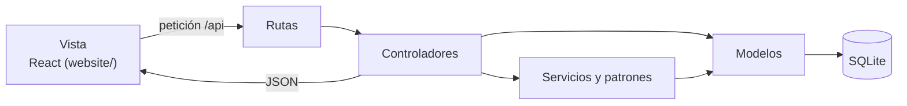

<div align="center">

</div>
<div align="center">
<a href="https://pyo3plataformanailstudio-production.up.railway.app"></a>

    

**Limón, Limón, Costa Rica** · Teléfono y WhatsApp **8532 6297**

Hecho por **Hyldia Thomas** y **Alice Arias** · Diseño de software · Instituto Tecnológico de Costa Rica

</div>
---


---

## Inicio rápido


No hay que instalar nada. Abre el sitio en cualquier navegador, en la computadora o en el celular:

**https://pyo3plataformanailstudio-production.up.railway.app**

| Quiero entrar como          | Dirección           | Usuario y contraseña                                                 |
| --------------------------- | -------------------- | --------------------------------------------------------------------- |
| **Clienta**           | El link de arriba    | Crea tu cuenta con**Entrar → Crear cuenta**                    |
| **Dueña del salón** | El link +`/admin`  | Contraseña:**`dueño123#`**                                  |
| **Especialista**      | El link +`/equipo` | El usuario y la contraseña que le da la dueña desde**Equipo** |

> [!TIP]
> Para entrar al panel, también puedes bajar hasta el final de cualquier página y tocar  **Acceso del salón** .


Se necesita tener instalado **Node.js 22** (se descarga en nodejs.org). Abre dos terminales en la carpeta del proyecto:

**Terminal 1, el servidor:**

```bash
cd api
npm install
npm run dev
```

**Terminal 2, el sitio:**

```bash
cd website
npm install
npm run dev
```

Después abre **http://localhost:5173** en el navegador.

> [!IMPORTANT]
> En la computadora, la contraseña del panel (`/admin`) es  **`cambia-esta-clave`** , salvo que se haya cambiado en la pestaña **Contraseña** del panel. La primera vez que se ejecuta, el sitio carga solo los datos de ejemplo (servicios, productos, especialistas y citas).

---

## Contenido

[Parte 1](https://img.shields.io/badge/PARTE_1-Para_las_clientas-8C1D4B?style=for-the-badge)

1. [Conocer la página](https://claude.ai/chat/cab41005-dffb-457a-b096-199569e6fe95?artifact=203e9573-c423-40cd-b7a7-efa65d7df9ef#1-conocer-la-p%C3%A1gina)
2. [Crear una cuenta o entrar](https://claude.ai/chat/cab41005-dffb-457a-b096-199569e6fe95?artifact=203e9573-c423-40cd-b7a7-efa65d7df9ef#2-crear-una-cuenta-o-entrar)
3. [Buscar ideas en la galería](https://claude.ai/chat/cab41005-dffb-457a-b096-199569e6fe95?artifact=203e9573-c423-40cd-b7a7-efa65d7df9ef#3-buscar-ideas-en-la-galer%C3%ADa)
4. [Diseñar mis uñas](https://claude.ai/chat/cab41005-dffb-457a-b096-199569e6fe95?artifact=203e9573-c423-40cd-b7a7-efa65d7df9ef#4-dise%C3%B1ar-mis-u%C3%B1as)
5. [Reservar una cita](https://claude.ai/chat/cab41005-dffb-457a-b096-199569e6fe95?artifact=203e9573-c423-40cd-b7a7-efa65d7df9ef#5-reservar-una-cita)
6. [Comprar en la tienda](https://claude.ai/chat/cab41005-dffb-457a-b096-199569e6fe95?artifact=203e9573-c423-40cd-b7a7-efa65d7df9ef#6-comprar-en-la-tienda)
7. [Pagar](https://claude.ai/chat/cab41005-dffb-457a-b096-199569e6fe95?artifact=203e9573-c423-40cd-b7a7-efa65d7df9ef#7-pagar)
8. [Ver, cambiar o cancelar mis citas](https://claude.ai/chat/cab41005-dffb-457a-b096-199569e6fe95?artifact=203e9573-c423-40cd-b7a7-efa65d7df9ef#8-ver-cambiar-o-cancelar-mis-citas)
9. [Favoritos, regalos y ayuda](https://claude.ai/chat/cab41005-dffb-457a-b096-199569e6fe95?artifact=203e9573-c423-40cd-b7a7-efa65d7df9ef#9-favoritos-regalos-y-ayuda)
10. [Opciones de accesibilidad](https://claude.ai/chat/cab41005-dffb-457a-b096-199569e6fe95?artifact=203e9573-c423-40cd-b7a7-efa65d7df9ef#10-opciones-de-accesibilidad)

[Parte 2](https://img.shields.io/badge/PARTE_2-Para_las_especialistas-A52A5E?style=for-the-badge)

11. [Entrar al portal del equipo](https://claude.ai/chat/cab41005-dffb-457a-b096-199569e6fe95?artifact=203e9573-c423-40cd-b7a7-efa65d7df9ef#11-entrar-al-portal-del-equipo)
12. [Mis citas, mis clientas y mi pago](https://claude.ai/chat/cab41005-dffb-457a-b096-199569e6fe95?artifact=203e9573-c423-40cd-b7a7-efa65d7df9ef#12-mis-citas-mis-clientas-y-mi-pago)
13. [Cancelar una cita o marcar que no llegó](https://claude.ai/chat/cab41005-dffb-457a-b096-199569e6fe95?artifact=203e9573-c423-40cd-b7a7-efa65d7df9ef#13-cancelar-una-cita-o-marcar-que-no-lleg%C3%B3)
14. [Pedir un día libre](https://claude.ai/chat/cab41005-dffb-457a-b096-199569e6fe95?artifact=203e9573-c423-40cd-b7a7-efa65d7df9ef#14-pedir-un-d%C3%ADa-libre)

[Parte 3](https://img.shields.io/badge/PARTE_3-Para_la_due%C3%B1a_del_sal%C3%B3n-5E2340?style=for-the-badge)

15. [Entrar al panel](https://claude.ai/chat/cab41005-dffb-457a-b096-199569e6fe95?artifact=203e9573-c423-40cd-b7a7-efa65d7df9ef#15-entrar-al-panel)
16. [La agenda](https://claude.ai/chat/cab41005-dffb-457a-b096-199569e6fe95?artifact=203e9573-c423-40cd-b7a7-efa65d7df9ef#16-la-agenda)
17. [Servicios, galería y productos](https://claude.ai/chat/cab41005-dffb-457a-b096-199569e6fe95?artifact=203e9573-c423-40cd-b7a7-efa65d7df9ef#17-servicios-galer%C3%ADa-y-productos)
18. [Pedidos de la tienda](https://claude.ai/chat/cab41005-dffb-457a-b096-199569e6fe95?artifact=203e9573-c423-40cd-b7a7-efa65d7df9ef#18-pedidos-de-la-tienda)
19. [El equipo](https://claude.ai/chat/cab41005-dffb-457a-b096-199569e6fe95?artifact=203e9573-c423-40cd-b7a7-efa65d7df9ef#19-el-equipo)
20. [Pagos al equipo](https://claude.ai/chat/cab41005-dffb-457a-b096-199569e6fe95?artifact=203e9573-c423-40cd-b7a7-efa65d7df9ef#20-pagos-al-equipo)
21. [Cierre del día](https://claude.ai/chat/cab41005-dffb-457a-b096-199569e6fe95?artifact=203e9573-c423-40cd-b7a7-efa65d7df9ef#21-cierre-del-d%C3%ADa)
22. [Gráficas](https://claude.ai/chat/cab41005-dffb-457a-b096-199569e6fe95?artifact=203e9573-c423-40cd-b7a7-efa65d7df9ef#22-gr%C3%A1ficas)
23. [Campanita de avisos y contraseña](https://claude.ai/chat/cab41005-dffb-457a-b096-199569e6fe95?artifact=203e9573-c423-40cd-b7a7-efa65d7df9ef#23-campanita-de-avisos-y-contrase%C3%B1a)

[Extra](https://img.shields.io/badge/EXTRA-Ayuda_r%C3%A1pida-C2366F?style=for-the-badge)

* [Preguntas frecuentes](https://claude.ai/chat/cab41005-dffb-457a-b096-199569e6fe95?artifact=203e9573-c423-40cd-b7a7-efa65d7df9ef#preguntas-frecuentes)
* [Reglas del salón](https://claude.ai/chat/cab41005-dffb-457a-b096-199569e6fe95?artifact=203e9573-c423-40cd-b7a7-efa65d7df9ef#reglas-del-sal%C3%B3n)

[Parte 4](https://img.shields.io/badge/PARTE_4-Informaci%C3%B3n_t%C3%A9cnica-22161C?style=for-the-badge)

24. [Tecnologías y colores del sitio](https://claude.ai/chat/cab41005-dffb-457a-b096-199569e6fe95?artifact=203e9573-c423-40cd-b7a7-efa65d7df9ef#24-tecnolog%C3%ADas)
25. [Páginas y direcciones del sitio](https://claude.ai/chat/cab41005-dffb-457a-b096-199569e6fe95?artifact=203e9573-c423-40cd-b7a7-efa65d7df9ef#25-p%C3%A1ginas-y-direcciones-del-sitio)
26. [Cómo funciona el diseñador de uñas](https://claude.ai/chat/cab41005-dffb-457a-b096-199569e6fe95?artifact=203e9573-c423-40cd-b7a7-efa65d7df9ef#26-c%C3%B3mo-funciona-el-dise%C3%B1ador-de-u%C3%B1as)
27. [Fotos](https://claude.ai/chat/cab41005-dffb-457a-b096-199569e6fe95?artifact=203e9573-c423-40cd-b7a7-efa65d7df9ef#27-fotos)
28. [Datos de ejemplo](https://claude.ai/chat/cab41005-dffb-457a-b096-199569e6fe95?artifact=203e9573-c423-40cd-b7a7-efa65d7df9ef#28-datos-de-ejemplo)
29. [Correr en la computadora](https://claude.ai/chat/cab41005-dffb-457a-b096-199569e6fe95?artifact=203e9573-c423-40cd-b7a7-efa65d7df9ef#29-correr-en-la-computadora)
30. [Comandos útiles](https://claude.ai/chat/cab41005-dffb-457a-b096-199569e6fe95?artifact=203e9573-c423-40cd-b7a7-efa65d7df9ef#30-comandos-%C3%BAtiles)
31. [Publicar en Railway](https://claude.ai/chat/cab41005-dffb-457a-b096-199569e6fe95?artifact=203e9573-c423-40cd-b7a7-efa65d7df9ef#31-publicar-en-railway)
32. [Cuentas de clientas con Google y Facebook](https://claude.ai/chat/cab41005-dffb-457a-b096-199569e6fe95?artifact=203e9573-c423-40cd-b7a7-efa65d7df9ef#32-cuentas-de-clientas-con-google-y-facebook)
33. [Arquitectura MVC](https://claude.ai/chat/cab41005-dffb-457a-b096-199569e6fe95?artifact=203e9573-c423-40cd-b7a7-efa65d7df9ef#33-arquitectura-mvc)
34. [Patrones de diseño (GoF)](https://claude.ai/chat/cab41005-dffb-457a-b096-199569e6fe95?artifact=203e9573-c423-40cd-b7a7-efa65d7df9ef#34-patrones-de-dise%C3%B1o-gof)
35. [Seguridad](https://claude.ai/chat/cab41005-dffb-457a-b096-199569e6fe95?artifact=203e9573-c423-40cd-b7a7-efa65d7df9ef#35-seguridad)
36. [Accesibilidad: cómo está hecha](https://claude.ai/chat/cab41005-dffb-457a-b096-199569e6fe95?artifact=203e9573-c423-40cd-b7a7-efa65d7df9ef#36-accesibilidad-c%C3%B3mo-est%C3%A1-hecha)
37. [Pendiente para producción](https://claude.ai/chat/cab41005-dffb-457a-b096-199569e6fe95?artifact=203e9573-c423-40cd-b7a7-efa65d7df9ef#37-pendiente-para-producci%C3%B3n)

---

<div align="center">

</div>
# Parte 1. Para las clientas

## 1. Conocer la página

Arriba de todas las páginas está el  **menú** :

| Opción                     | Para qué sirve                                       |
| --------------------------- | ----------------------------------------------------- |
| **Más vendidos**     | Los productos que más compran otras clientas         |
| **Ofertas**           | Productos con descuento por tiempo limitado           |
| **Servicios**         | Todos los servicios del salón con precio y duración |
| **Galería**          | Fotos de trabajos para inspirarte                     |
| **Diseña tus uñas** | Crea tu diseño uña por uña y mira el precio        |
| **Tienda**            | Esmaltes, herramientas, cuidado de manos y más       |
| **Reservar**          | Apartar tu cita                                       |
| **Ayuda**             | Datos del salón, horario y preguntas frecuentes      |
| **Entrar**            | Tu cuenta                                             |
| **Corazón**          | Tus favoritos                                         |
| **Carrito**           | Lo que vas a comprar o reservar                       |

**Buscador:** escribe lo que buscas, por ejemplo «francesa» o «rubber base». Mientras escribes aparecen servicios, productos y diseños. Toca el que quieras o presiona Enter para ver todos los resultados.

 **En el celular** , el menú se abre con el botón de tres rayitas, arriba a la derecha.

---

## 2. Crear una cuenta o entrar

Para comprar o reservar necesitas una cuenta.

1. Toca  **Entrar** , arriba a la derecha.
2. Si ya tienes cuenta, escribe tu correo y tu contraseña.
3. Si es la primera vez, toca **Crear cuenta** y llena tu nombre, correo, teléfono y una contraseña.
4. Si el salón lo activó, también puedes entrar con **Google** o  **Facebook** .

> [!CAUTION]
> Si escribes mal la contraseña 5 veces, tienes que esperar 5 minutos antes de volver a intentar.

---

## 3. Buscar ideas en la galería

1. Toca **Galería** en el menú.
2. Usa los botones de arriba para filtrar por  **tipo de servicio** ,  **forma** , **color** y  **acabado** . Puedes marcar varios a la vez.
3. Con **Ordenar por** eliges ver los más recientes, los más populares o los más antiguos.
4. Toca una foto para verla en grande, con sus detalles y diseños parecidos.
5. Si te gusta, toca **Reservar este diseño** y la reserva empieza con ese diseño ya elegido.

> [!TIP]
> Los filtros quedan guardados en el link. Puedes copiarlo y mandárselo a una amiga.

---

## 4. Diseñar mis uñas

Aquí creas tu diseño y lo ves al instante sobre una mano real.

1. Toca **Diseña tus uñas** en el menú.
2. **¿Qué uñas quieres cambiar?** Elige **Las 5 uñas** para cambiarlas todas juntas, o **Una sola uña** y toca la uña que quieres. Lo que elijas solo cambia esa uña.
3. **Forma y largo:** almendra, cuadrada, redonda, stiletto, coffin, ovalada, squoval o ballerina, y el largo que prefieras.
4. **Color:** toca un esmalte. Hay más de 270 colores con su código (por ejemplo, AH-001).
5. **Acabado:** brillante, mate, chrome, glitter y otros.
6. **Decoraciones:** perlas, cristales, stickers, polvos, flores 3D, foil, charms o líneas finas. Eliges en qué uña va cada una.
7. **Tono de piel:** cambia el color de la mano para verlo más parecido a ti.

Mientras diseñas:

* **El precio** se actualiza al instante.
* **Fotos parecidas:** aparecen fotos reales de trabajos parecidos a tu diseño.
* **Vista de cerca:** con **En la mano / De cerca** cambias la forma de verlo.

Cuando termines, guarda el diseño y llévalo a tu reserva. Tu especialista lo revisa contigo antes de empezar.

---

## 5. Reservar una cita

La reserva tiene  **3 pasos** , y la barra de arriba te muestra en cuál vas.

1. **Servicio:** elige qué te quieres hacer. Puedes filtrar por manos, uñas acrílicas, gel, pies, tratamientos, diseños, combos y servicios para hombres.
2. **Fecha y hora:** elige la especialista y el día. Solo aparecen las horas libres.
3. **Revisar y agregar:** revisa todo y toca  **Agregar al carrito** .

**¿Vas con alguien más?** En el paso 3 puedes agregar la cita de tu acompañante: con la misma especialista a la hora siguiente, o con otra a la misma hora.

Después ve al **carrito** y paga el adelanto (ver [Pagar](https://claude.ai/chat/cab41005-dffb-457a-b096-199569e6fe95?artifact=203e9573-c423-40cd-b7a7-efa65d7df9ef#7-pagar)).

> [!NOTE]
> Cada cita es para una persona con un solo diseño.

---

## 6. Comprar en la tienda

1. Toca **Tienda** en el menú.
2. Toca un  **círculo de categoría** : esmaltes y geles, rubber base, herramientas, limas, cuidado de manos, pedicure, manicure pro, aceites, decoración o para hombres.
3. Usa los filtros de  **categoría** , **precio** y  **solo disponibles** , o el buscador.
4. Toca un producto para ver sus fotos, descripción y reseñas.
5. Elige la cantidad y toca  **Agregar al carrito** .

**Productos agotados:** se ven en gris. Puedes tocar **Ver artículos similares** o  **Avisarme por WhatsApp** .

**Reseñas:** puedes escribir la tuya. Si pones tu número de pedido y tu teléfono, sale como  **compra verificada** .

---

## 7. Pagar

1. Toca el  **carrito** , arriba a la derecha, para revisar tus productos y citas.
2. Toca  **Finalizar compra** .
3. Revisa tus datos. Los productos se  **recogen gratis en el salón** .
4. Si tienes un  **cupón** , escríbelo y toca aplicar.
5. Elige cómo pagar:

| Forma de pago          | Cómo funciona                                                                     |
| ---------------------- | ---------------------------------------------------------------------------------- |
| **SINPE Móvil** | Haces el SINPE al número del salón y escribes el comprobante                     |
| **Tarjeta**      | Débito o crédito. Nunca se guarda el número completo ni el código de seguridad |
| **En el salón** | Pagas cuando llegues                                                               |

6. Toca **Confirmar** y te sale la confirmación.

> [!IMPORTANT]
> **Cuánto se paga ahora:** los productos se pagan completos y las citas el **30 %** como adelanto. El resto de la cita se paga en el salón.

---

## 8. Ver, cambiar o cancelar mis citas

1. Toca **Entrar** (tu cuenta) y ve a  **Mis pedidos y citas** .
2. Ahí ves tus próximas citas y tus compras anteriores.
3. Para cancelar, toca **Cancelar** en la cita.

> [!WARNING]
> solo puedes cancelar **hasta 2 horas antes** de tu cita. Si falta menos, escríbenos por WhatsApp al  **8532 6297** . Tu adelanto queda a tu favor para la nueva cita.

En tu cuenta también puedes guardar tus  **direcciones** .

---

## 9. Favoritos, regalos y ayuda

**Favoritos:** toca el **corazón** en cualquier diseño o producto para guardarlo. Los ves todos tocando el corazón del menú.

**Regalos sorpresa:**

* **Ruleta:** a veces aparece una ruleta de premios. Gírala y, si te sale un cupón, se guarda para tu compra.
* **Cupones:** pueden aparecer al agregar un combo al carrito o al llegar a cierto monto.

**Asistente virtual:** abajo a la derecha está  **Sofi** , el asistente virtual del sitio. Te ayuda con precios, horarios, formas de pago y cómo reservar.

**Ayuda y contacto:** en **Ayuda** encuentras:

* la dirección, el horario y si el salón está abierto ahora;
* el teléfono y el botón de WhatsApp;
* las preguntas frecuentes;
* un formulario que abre WhatsApp con tu mensaje listo para enviar.

---

## 10. Opciones de accesibilidad

Toca el **botón azul** del lado izquierdo para abrir el menú de accesibilidad:

| Opción                                 | Qué hace                               |
| --------------------------------------- | --------------------------------------- |
| **Tamaño**                       | Agranda o achica la letra               |
| **Leer esta página en voz alta** | El sitio te lee el contenido            |
| **Modo nocturno**                 | Fondo oscuro, descansa la vista         |
| **Escala de grises**              | Quita los colores                       |
| **Leer al señalar**              | Lee en voz alta lo que tocas o señalas |
| **Pausar animaciones**            | Todo queda quieto                       |
| **Modo sencillo**                 | Letras grandes, menos cosas a la vez    |

Tus opciones se guardan para la próxima visita. Para volver a como estaba, toca  **Restablecer todo** .

También puedes usar todo el sitio  **solo con el teclado** : la tecla Tab avanza, Enter elige y Escape cierra las ventanas.

---

<div align="center">

</div>
# Parte 2. Para las especialistas

## 11. Entrar al portal del equipo

1. Al final de cualquier página, toca  **Acceso del equipo** . También puedes escribir `/equipo` al final del link del sitio.
2. Escribe el **usuario** y la **contraseña** que te dio la dueña.
3. Toca  **Entrar** .

> [!NOTE]
> Solo ves  **tu información** : tus citas, tus clientas y tu pago. Nunca la de tus compañeras.

---

## 12. Mis citas, mis clientas y mi pago

El portal tiene 4 pestañas:

| Pestaña               | Qué ves                                                                                                                                |
| ---------------------- | --------------------------------------------------------------------------------------------------------------------------------------- |
| **Mis citas**    | Tus citas de los próximos 14 días con nombre, teléfono, servicio, diseño y notas de cada clienta. Cada una tiene botón de WhatsApp |
| **Mis clientas** | Las clientas que has atendido                                                                                                           |
| **Mi pago**      | Lo que llevas ganado en la quincena. Ganas el**65 %**de lo que atiendes                                                                 |
| **Días libres** | Tus días libres y vacaciones, y el calendario para pedir días                                                                         |

**Días de pago:** el **15** y el **último día** de cada mes. Si cae domingo, se paga el sábado antes. Solo cuentan las citas marcadas como atendidas.

---

## 13. Cancelar una cita o marcar que no llegó

**Cancelar una cita** (solo hasta 2 horas antes):

1. En  **Mis citas** , toca  **Cancelar cita** .
2. Elige el **motivo** y si le ofreces otro día.
3. Se abre WhatsApp con el mensaje para la clienta ya escrito. Solo tienes que enviarlo.

**Si la clienta no llegó** (después de la hora de la cita):

1. Toca  **No llegó** .
2. Decide qué hacer:
   * **Reprogramar:** eliges otra fecha, sin costo, y se guarda el adelanto.
   * **Cobrar:** el adelanto, la mitad, el total u otro monto.
3. Se prepara el mensaje de WhatsApp para la clienta.

---

## 14. Pedir un día libre

1. Ve a la pestaña **Días libres** y busca  **Pedir días libres** .
2. En el calendario, toca el día que necesitas. Si son varios días seguidos, toca también el último. Escribe el motivo y envía la solicitud.
3. Tu solicitud le llega a la dueña en la  **campanita de avisos** .
4. Si la aprueba, ese día ya no se pueden reservar citas contigo.

---

<div align="center">

</div>
# Parte 3. Para la dueña del salón

## 15. Entrar al panel

1. Al final de cualquier página, toca  **Acceso del salón** . También puedes escribir `/admin` al final del link del sitio.
2. Escribe la  **contraseña del panel** .
3. Toca  **Entrar** .

> [!IMPORTANT]
> En el sitio publicado, la contraseña del panel es  **`dueño123#`** . Se puede cambiar en la pestaña **Contraseña** (ver [Contraseña](https://claude.ai/chat/cab41005-dffb-457a-b096-199569e6fe95?artifact=203e9573-c423-40cd-b7a7-efa65d7df9ef#23-campanita-de-avisos-y-contrase%C3%B1a)).

El menú de la izquierda está ordenado en grupos:  **Salón** ,  **Tienda** , **Equipo** y  **Números** .

---

## 16. La agenda

**El calendario:** cada día muestra cuántos espacios están ocupados. El color indica qué tan lleno está, y el número rojo indica las citas por confirmar.

**Ver un día:**

1. Toca un día del calendario.
2. A la derecha ves las citas por atender, las atendidas, las canceladas y lo que falta por cobrar.
3. Puedes buscar una clienta o filtrar por especialista.

**Qué puedes hacer con cada cita:**

* **Atendida:** márcala cuando la clienta ya se fue.
* **No llegó:** reprogramar o cobrar, igual que en el portal del equipo.
* **Cancelar por emergencia:** tú puedes cancelar siempre, aunque falten menos de 2 horas.
* **WhatsApp:** avisarle a la clienta con el mensaje ya escrito.

---

## 17. Servicios, galería y productos

**Servicios**

* Toca **Servicios** para ver todos.
* Puedes **agregar** uno nuevo o **modificar** el precio, la oferta, la duración, la categoría, lo que incluye y la foto.
* También puedes **ocultarlo** (no se ve en el sitio pero no se borra) o  **eliminarlo** .

**Galería**

1. Toca  **+ Agregar nueva imagen** .
2. Sube la foto y llena el título, el servicio, la forma, el color y el acabado. Así funcionan los filtros de la galería.
3. Si quieres, ponle un  **precio propio** . Si lo dejas vacío, usa el precio del servicio.
4. Marca **destacada** la que quieras mostrar en la portada.

**Productos**

* Agrega o edita productos: nombre, precio, oferta, cantidad disponible y foto.
* Arriba están las tarjetas de  **«Fotos de los círculos de categorías»** . Con ellas puedes:
  * **cambiar la foto** de un círculo;
  * **ocultar** un círculo;
  * **agregar** al Inicio el círculo de una categoría de la tienda.

---

## 18. Pedidos de la tienda

1. Toca  **Pedidos** .
2. Filtra por estado, forma de pago o busca por nombre.
3. Cambia el estado del pedido según avanza:  **Recibido → Listo para retirar → Entregado** .
4. Toca **Descargar Excel** para bajar la lista.

---

## 19. El equipo

Cada especialista tiene el botón  **Abrir ficha** , con 4 partes:

| Parte                              | Qué se configura                                                               |
| ---------------------------------- | ------------------------------------------------------------------------------- |
| **1. Datos**                 | Nombre, foto, especialidad y horario de trabajo                                 |
| **2. Pago y estación**      | Forma de pago (comisión o base + comisión), porcentaje y estación de trabajo |
| **3. Días libres**          | Vacaciones y días libres. Ese día no se puede reservar con ella               |
| **4. Usuario y contraseña** | Acceso al portal del equipo                                                     |

**Darle acceso a una especialista:**

1. Abre su ficha y ve a  **Usuario y contraseña** .
2. Escribe un usuario y una contraseña, o toca  **Inventar una contraseña segura** .
3. Toca  **Dar acceso** .
4. Dale los datos  **en persona** .

---

## 20. Pagos al equipo

1. Toca  **Pagos al equipo** .
2. Elige la  **quincena** .
3. Por cada especialista ves:
   * las citas atendidas y lo vendido;
   * su comisión y el total a pagar;
   * los días trabajados, libres y ausencias.
4. Cuando le pagues, toca  **Marcar como pagado** .
5. Toca **Descargar Excel** si lo necesitas.

> [!TIP]
> Si quedan citas de días pasados sin marcar, aparece un aviso con un botón para **marcarlas todas** como atendidas.

---

## 21. Cierre del día

Al final de cada día, revisa cómo le fue al salón. Después de las **5 p. m.** el panel te avisa que ya está listo.

| Dato                          | Qué significa                                           |
| ----------------------------- | -------------------------------------------------------- |
| **Ingresos**            | Todo lo que entró: citas y tienda                       |
| **Pago al equipo**      | La comisión de cada especialista por lo que atendió    |
| **Ganancia del salón** | Ingresos menos el pago al equipo                         |
| **Pérdidas**           | Lo que se perdió por citas canceladas o que no llegaron |

Debajo ves una **tabla por especialista** y la  **lista de citas perdidas** , con lo que pasó en cada una.

* Con las **flechas** ves el cierre de otros días.
* Toca **Imprimir** o **Enviar por WhatsApp** para guardarlo o compartirlo.

---

## 22. Gráficas

1. Elige el periodo:  **últimos 7 días** ,  **últimos 30 días** ,  **este mes** ,  **mes pasado** , **este año** o fechas a tu gusto.
2. Mira:
   * las ventas por día o por mes;
   * las citas por especialista;
   * los servicios y productos más vendidos;
   * las formas de pago;
   * cómo terminaron las citas.
3. Cada gráfica se puede **descargar como imagen** o  **para Excel** .

---

## 23. Campanita de avisos y contraseña

**Campanita de avisos:** arriba a la derecha, con un número rojo. Al tocarla ves:

* los días libres que pidieron las especialistas, que puedes **aprobar** o **no aprobar** desde ahí;
* los pedidos nuevos por preparar;
* las citas por confirmar;
* las citas de días pasados sin marcar.

**Cambiar la contraseña del panel:**

1. En el menú de la izquierda, toca  **Contraseña** .
2. Escribe la actual y la nueva dos veces. Debe tener al menos 8 caracteres, con letras y números.
3. Toca  **Cambiar contraseña** . Las sesiones abiertas en otros aparatos se cierran.

---

## Preguntas frecuentes

**¿Puedo usar el sitio desde el celular?**
Sí. Todo funciona igual en el celular, la tablet y la computadora.

**¿Mis datos de tarjeta están seguros?**
Sí. El salón nunca guarda el número completo ni el código de seguridad de tu tarjeta.

**¿Qué pasa si no llego a mi cita?**
Te escribimos por WhatsApp. Según el caso, se reprograma o se cobra (normalmente el adelanto).

**¿Y si se me levanta una uña?**
Si pasa en los primeros 5 días después de tu cita, la arreglamos sin costo.

**¿Cómo recojo lo que compré?**
Los productos se retiran gratis en el salón. Te avisamos cuando tu pedido esté listo.

**Olvidé mi contraseña, ¿qué hago?**
Escríbenos por WhatsApp al 8532 6297 y te ayudamos.

---

## Reglas del salón

| Regla                              | Detalle                                                        |
| ---------------------------------- | -------------------------------------------------------------- |
| **Cancelar**                 | Hasta 2 horas antes de la cita                                 |
| **Adelanto**                 | 30 % de la cita al reservar; el resto en el salón             |
| **No llegó**                | La dueña o la especialista decide si se reprograma o se cobra |
| **Comisión del equipo**     | 65 % para la especialista y 35 % para el salón                |
| **Días de pago del equipo** | El 15 y el último día de cada mes                            |
| **Uña levantada**           | Arreglo sin costo en los primeros 5 días                      |

---

<div align="center">

</div>
# Parte 4. Información técnica

Esta parte es para quien programa o mantiene el sitio. La explicación completa de MVC, patrones GoF, GRASP y SOLID está en [`DOCUMENTACION.md`](https://claude.ai/chat/DOCUMENTACION.md).

## 24. Tecnologías

| Parte                | Tecnología                                                     | Carpeta          |
| -------------------- | --------------------------------------------------------------- | ---------------- |
| Sitio (lo que se ve) | React + Vite                                                    | `website/`     |
| Servidor             | Node.js + Express                                               | `api/`         |
| Base de datos        | SQLite (`better-sqlite3`)                                     | `api/naile.db` |
| Fotos subidas        | Se guardan en el servidor                                       | `uploads/`     |
| Publicación         | Railway (un solo servicio entrega el sitio, la API y las fotos) | —               |

### Colores del sitio

| Muestra                                                                                                                                                                 | Nombre      | Código     | Dónde se usa                              |
| ----------------------------------------------------------------------------------------------------------------------------------------------------------------------- | ----------- | ----------- | ------------------------------------------ |
| [https://img.shields.io/badge/%E2%80%83%E2%80%83%E2%80%83-8C1D4B?style=for-the-badge](https://img.shields.io/badge/%E2%80%83%E2%80%83%E2%80%83-8C1D4B?style=for-the-badge) | Vino        | `#8C1D4B` | Color principal: menú, botones y títulos |
| [https://img.shields.io/badge/%E2%80%83%E2%80%83%E2%80%83-6E1539?style=for-the-badge](https://img.shields.io/badge/%E2%80%83%E2%80%83%E2%80%83-6E1539?style=for-the-badge) | Vino oscuro | `#6E1539` | Botones importantes y textos destacados    |
| [https://img.shields.io/badge/%E2%80%83%E2%80%83%E2%80%83-F7ECE8?style=for-the-badge](https://img.shields.io/badge/%E2%80%83%E2%80%83%E2%80%83-F7ECE8?style=for-the-badge) | Rosa nude   | `#F7ECE8` | Fondo de las páginas                      |
| [https://img.shields.io/badge/%E2%80%83%E2%80%83%E2%80%83-F1DCD7?style=for-the-badge](https://img.shields.io/badge/%E2%80%83%E2%80%83%E2%80%83-F1DCD7?style=for-the-badge) | Rubor       | `#F1DCD7` | Tarjetas y bordes suaves                   |
| [https://img.shields.io/badge/%E2%80%83%E2%80%83%E2%80%83-22161C?style=for-the-badge](https://img.shields.io/badge/%E2%80%83%E2%80%83%E2%80%83-22161C?style=for-the-badge) | Tinta       | `#22161C` | Texto principal                            |
| [https://img.shields.io/badge/%E2%80%83%E2%80%83%E2%80%83-1F6B45?style=for-the-badge](https://img.shields.io/badge/%E2%80%83%E2%80%83%E2%80%83-1F6B45?style=for-the-badge) | Verde       | `#1F6B45` | Mensajes de que todo salió bien           |
| [https://img.shields.io/badge/%E2%80%83%E2%80%83%E2%80%83-A3122A?style=for-the-badge](https://img.shields.io/badge/%E2%80%83%E2%80%83%E2%80%83-A3122A?style=for-the-badge) | Rojo        | `#A3122A` | Errores y avisos                           |

**Letras:** Poppins para los títulos y Nunito Sans para el texto. El logo usa una letra cursiva (Great Vibes) con las palabras «Nails Studio».

---

## 25. Páginas y direcciones del sitio

| Página             | Dirección            | Qué hace                                                                                                                               |
| ------------------- | --------------------- | --------------------------------------------------------------------------------------------------------------------------------------- |
| Inicio              | `/`                 | Portada, círculos de categorías, servicios, diseños destacados, tienda y reseñas                                                    |
| Servicios           | `/servicios`        | Unos 30 servicios en 8 categorías, con precio, duración, filtros y botón para reservar                                               |
| Galería            | `/galeria`          | Fotos reales con buscador, filtros (servicio, forma, color, acabado) y orden. Los filtros quedan en la dirección y se pueden compartir |
| Detalle de diseño  | `/galeria/:id`      | Foto grande, datos, diseños parecidos y «Reservar este diseño»                                                                      |
| Diseña tus uñas   | `/disena`           | Diseñador paso a paso sobre la foto de una mano, uña por uña, con precio en vivo                                                     |
| Reservar            | `/reservar`         | Servicio, especialista, día y hora libres, y pasa al carrito                                                                           |
| Tienda              | `/tienda`           | Unos 450 productos con filtros, orden, buscador y carrito                                                                               |
| Detalle de producto | `/tienda/:id`       | Fotos, precio, reseñas y productos parecidos                                                                                           |
| Carrito             | `/carrito`          | Productos y citas juntos                                                                                                                |
| Finalizar compra    | `/finalizar-compra` | Datos, método de pago, cupón y resumen                                                                                                |
| Mi cuenta           | `/cuenta`           | Pedidos, citas (cancelar hasta 2 horas antes) y direcciones                                                                             |
| Favoritos           | `/favoritos`        | Diseños y productos guardados con el corazón                                                                                          |
| Buscar              | `/buscar`           | Resultados de servicios, productos y diseños                                                                                           |
| Ayuda y contacto    | `/contacto`         | Datos del salón, horario, preguntas frecuentes y mensaje por WhatsApp                                                                  |
| Portal del equipo   | `/equipo`           | Entrada de las especialistas                                                                                                            |
| Panel               | `/admin`            | Panel de la dueña                                                                                                                      |

**El buscador del encabezado** muestra resultados mientras se escribe y se puede usar con las flechas y Enter.

---

## 26. Cómo funciona el diseñador de uñas

* **Cómo se ve:** se usa una foto real de una mano sin uñas (`website/public/img/mano.jpg`). Encima se dibuja cada uña con su forma, largo, color, acabado y decoración. Con `mano-mascara.png` se cambia el tono de piel.
* **Uña por uña:** se puede cambiar las 5 uñas juntas o una sola. Tocar una uña cambia solo esa.
* **Decoraciones:** perlas, cristales, stickers, polvos, flores 3D, foil, charms y líneas finas, eligiendo en qué uña y en qué parte va cada una.
* **273 esmaltes** con código (AH-001…), en `api/src/db/esmaltes.js` y copiados en `website/src/lib/esmaltes.js`. Los dos archivos deben ser iguales.
* **Fotos parecidas:** debajo del diseño salen fotos reales parecidas. Cuentan más las decoraciones, después el color y al final la forma.

**Cómo se calcula el precio:**

| Parte                                   | Cómo se cobra                                         |
| --------------------------------------- | ------------------------------------------------------ |
| Largo                                   | Una vez por juego                                      |
| Acabado, decoración y esmalte especial | Por uña, por 2 (las dos manos)                        |
| Decoraciones pegadas                    | Precio por uña × uñas elegidas × 2 manos           |
| Colores combinados                      | +₡500 por cada color de más (el primero va incluido) |

Al guardar el diseño, el servidor vuelve a calcular el precio (patrón Builder).

Si se cambia la foto de la mano, hay que volver a medir cada uña en `website/src/components/ManoFoto.jsx`.

---

## 27. Fotos

Todas las fotos de muestra son **gratuitas de Unsplash** y muestran el nombre de su fotógrafa. No se usan fotos de Pinterest, con marca de agua ni de pago.

**Clave de Unsplash:**

1. Crear una cuenta en https://unsplash.com/developers.
2. Hacer una «New Application» y copiar el  *Access Key* .
3. **La clave nunca va en el código ni en GitHub.** Se escribe solo en la terminal antes del comando (PowerShell):

```powershell
$env:UNSPLASH_KEY="su_access_key"
```

Unsplash permite 50 consultas por hora. Si un comando se corta, se vuelve a correr una hora después y sigue donde quedó.

| Para qué                                              | Comando (dentro de `api/`)                 |
| ------------------------------------------------------ | -------------------------------------------- |
| Unas 200 fotos para la galería                        | `npm run fotos -- 200`                     |
| Fotos de decoraciones (perlas, cristales, flores 3D…) | `npm run fotos -- 150 --decoraciones`      |
| Fotos de los productos                                 | `npm run fotos-productos`                  |
| Reemplazar también las que ya tienen foto             | `npm run fotos-productos -- --todas`       |
| Fotos de muestra de las especialistas                  | `npm run fotos-especialistas`              |
| Fotos de muestra de las clientas                       | `npm run fotos-clientas`                   |
| Importar fotos del salón desde una carpeta            | `npm run importar -- "ruta/de/la/carpeta"` |
| Volver a escribir las descripciones en español        | `npm run describir-fotos`                  |

**Llevar las fotos al sitio publicado (Railway).** La base de datos y la carpeta `uploads` de la computadora no se suben a GitHub. Para que todas las fotos salgan también en el sitio publicado (las de Unsplash y las subidas desde el panel):

1. Dentro de `api/`, corre `npm run exportar-fotos`. Esto guarda las direcciones en `api/src/db/fotosGuardadas.json` y copia las fotos subidas a la carpeta `api/fotos-subidas`.
2. Súbelo con `git add -A`, `git commit -m "Fotos"` y `git push`.
3. Al volver a prender, Railway carga las fotos que le falten, sin repetir ni borrar las que se cambiaron allá.

Cada vez que agregues fotos en la computadora, repite los 3 pasos.

* **Descripciones en español:** al prender el servidor, cada foto recibe una sola vez una descripción y etiquetas (colores, forma, técnica, decoraciones). Así el diseñador encuentra más fotos parecidas.
* **Nombres al importar:** las fotos del salón deben tener nombres descriptivos, por ejemplo «francesa rosa almendra.jpg».
* **Para el sitio real:** usen fotos del equipo de verdad. Las clientas deben ver a quien las va a atender.

---

## 28. Datos de ejemplo

Para que la demo se vea como un salón funcionando, la base de datos trae datos de muestra:

* 10 especialistas.
* Citas de los últimos 60 días y de los próximos días.
* Pedidos de la tienda.
* Reseñas y comentarios.

Las citas de muestra que ya pasaron se marcan solas como atendidas cada 15 minutos. **Las citas reales nunca se tocan.**

**Antes de abrir el sitio al público, borren todo lo de muestra.** Dentro de `api/`:

```bash
npm run limpiar
```

---

## 29. Correr en la computadora

Se necesita  **Node.js 22** .

```bash
# Terminal 1: el servidor
cd api
npm install
npm run dev          # http://localhost:3001

# Terminal 2: el sitio
cd website
npm install
npm run dev          # http://localhost:5173
```

**Para ver la base de datos:** en VS Code, instalen la extensión **SQLite Viewer** y abran `api/naile.db`.

---

## 30. Comandos útiles

Todos se corren dentro de `api/`.

| Comando                                              | Qué hace                                                                                                                                  |
| ---------------------------------------------------- | ------------------------------------------------------------------------------------------------------------------------------------------ |
| `npm run dev`                                      | Prende el servidor y lo reinicia al guardar cambios                                                                                        |
| `npm start`                                        | Prende el servidor                                                                                                                         |
| `npm run seed`                                     | Carga los datos iniciales                                                                                                                  |
| `npm run limpiar`                                  | Borra todos los datos de muestra                                                                                                           |
| `npm run cambiar-contrasena -- correo clave`       | Cambia la contraseña de una cuenta                                                                                                        |
| `npm run exportar-fotos`                           | Guarda las fotos de Unsplash para llevarlas al sitio publicado                                                                             |
| `npm run fotos`,`fotos-productos`,`importar`… | Ver la[sección de fotos](https://claude.ai/chat/cab41005-dffb-457a-b096-199569e6fe95?artifact=203e9573-c423-40cd-b7a7-efa65d7df9ef#27-fotos) |

---

## 31. Publicar en Railway

1. **GitHub:** subir el proyecto a GitHub.
2. **Crear el proyecto:** en Railway,  **New Project → Deploy from GitHub repo** .
3. **Settings:** Build Command `npm run build` y Start Command `npm start`.
4. **Volume:** agregar uno montado en `/data`. Ahí viven la base de datos y las fotos; sin él se borran en cada publicación.
5. **Variables:**

| Variable                                     | Valor                                                                                      |
| -------------------------------------------- | ------------------------------------------------------------------------------------------ |
| `DB_PATH`                                  | `/data/naile.db`                                                                         |
| `UPLOADS_DIR`                              | `/data/uploads`                                                                          |
| `ADMIN_TOKEN`                              | Una clave larga que solo conozca el salón                                                 |
| `NODE_ENV`                                 | `production`                                                                             |
| `TZ`                                       | `America/Costa_Rica`(para que el cierre del día y las citas usen la hora de Costa Rica) |
| `COSTO_ENVIO`                              | Opcional: precio del envío a domicilio, por ejemplo `2500`                              |
| `GOOGLE_CLIENT_ID`                         | Opcional: para entrar con Google                                                           |
| `FACEBOOK_APP_ID`y `FACEBOOK_APP_SECRET` | Opcional: para entrar con Facebook                                                         |

6. **Dirección pública:**  **Networking → Generate Domain** . Si el salón tiene dominio propio, se conecta en  **Custom Domain** .

---

## 32. Cuentas de clientas con Google y Facebook

Con **correo y contraseña** funciona sin configurar nada.

Los botones de **Google** y **Facebook** se activan solos cuando existen sus variables:

**Google**

1. Entrar a https://console.cloud.google.com.
2. Ir a *APIs y servicios → Credenciales → Crear ID de cliente de OAuth* (tipo  *Aplicación web* ).
3. En  *Orígenes autorizados* , poner `http://localhost:5173` y la dirección de Railway.
4. Copiar el ID en `GOOGLE_CLIENT_ID`.

**Facebook**

1. Entrar a https://developers.facebook.com → *Crear app* →  *Inicio de sesión con Facebook* .
2. Agregar el dominio de Railway.
3. Copiar el identificador en `FACEBOOK_APP_ID` y la clave secreta en `FACEBOOK_APP_SECRET`.

Ninguna de estas claves va en el código ni en GitHub: solo en las variables.

---

## 33. Arquitectura MVC

| Capa                  | Dónde                   | Qué hace                                                                                |
| --------------------- | ------------------------ | ---------------------------------------------------------------------------------------- |
| **Modelo**      | `api/src/models/`      | Guarda y lee datos. Es la única capa que habla con SQLite                               |
| **Vista**       | `website/`(React)      | Lo que ven las clientas, el equipo y la dueña. Pide todo al servidor por `lib/api.js` |
| **Controlador** | `api/src/controllers/` | Recibe cada petición, llama al modelo o al servicio y responde                          |
| Rutas                 | `api/src/routes/`      | Solo conectan cada dirección con su controlador                                         |
| Servicios             | `api/src/servicios/`   | Reglas que usan varias pantallas (cancelar citas, citas perdidas)                        |



**Ejemplo: comprar una cita.**

1. **Vista:** `FinalizarCompra.jsx` envía `POST /api/pedidos`.
2. **Ruta:** `publicRoutes.js` revisa que haya sesión y llama a `pedidoController.crear`.
3. **Controlador:** recalcula precios y cupón (Decorator), cobra con el método elegido (Strategy + Factory) y guarda todo junto.
4. **Modelo:** `CitaModel` y `PedidoModel` guardan en SQLite. El evento `cita:creada` (Observer) programa los recordatorios.
5. **Vista:** recibe la respuesta y muestra la confirmación.

**Carpetas**

```
api/src/
  index.js        arranque del servidor
  db/             conexión (Singleton), tablas, datos de ejemplo y comandos de fotos
  models/         un modelo por tema (Cita, Pedido, Producto, Usuario, Nómina…)
  controllers/    un controlador por sección
  routes/         publicRoutes (sitio), adminRoutes (panel), equipoRoutes (portal)
  servicios/      reglas compartidas (cancelar, no llegó)
  patrones/       patrones de diseño, un archivo por patrón
  middleware/     sesiones (dueña, equipo, clientas) y subida de fotos
  lib/            ayudantes, por ejemplo cuentas con fechas

website/src/
  main.jsx, App.jsx   arranque y lista de páginas
  pages/              una página por archivo; pages/admin/ es el panel
  components/         piezas que se repiten (tarjetas, encabezado, mano, ventanas)
  context/            datos compartidos: carrito, favoritos, cuenta, reserva
  patrones/           Chain of Responsibility y Builder
  lib/                conexión con el servidor, esmaltes, ayudantes
  estilos/            hojas de estilo, una por sección
```

**Cómo está escrito el código**

* Todo está en español y con nombres que dicen qué guardan: `respuesta`, `cita`, `gananciaSalon`, `horasLibres`.
* Cada archivo empieza con un comentario que dice para qué sirve.
* Cada función tiene cinco líneas de comentario: Nombre, Descripción, Entrada, Salida y Objetivo.
* Los cálculos difíciles tienen una nota que los explica.

---

## 34. Patrones de diseño (GoF)

**12 usos de 10 patrones distintos.** Cada uno está en un archivo con el nombre del patrón.

| #  | Patrón                    | Archivo                                                         | Para qué se usa                                                                                                     |
| -- | -------------------------- | --------------------------------------------------------------- | -------------------------------------------------------------------------------------------------------------------- |
| 1  | Singleton                  | `api/src/db/conexion.js`                                      | Una sola conexión a la base de datos para toda la aplicación                                                       |
| 2  | Strategy                   | `estrategiaPagos.js`                                          | SINPE Móvil, tarjeta o pago en el salón con el mismo método `cobrar()`                                          |
| 3  | Strategy                   | `estrategiaAutenticacion.js`                                  | Entrar con formulario, Google o Facebook con el mismo método                                                        |
| 4  | Factory Method             | `crearMetodoPago()`,`crearEsquemaPago()`,`crearMensaje()` | Se pide la opción por nombre y la fábrica entrega la clase correcta                                                |
| 5  | Decorator                  | `decoradorPrecio.js`                                          | El precio del pedido se arma por capas: precio base → cupón (porcentaje o monto)                                   |
| 6  | Builder                    | `constructorDiseno.js`(servidor y sitio)                      | El diseño de uñas se arma paso a paso y calcula su precio                                                          |
| 7  | State                      | `estadoCita.js`y `estadoPedido.js`                          | Una cita o un pedido solo pasa a los estados permitidos                                                              |
| 8  | Observer                   | `observadorEventos.js`y `website/src/context/`              | Al crear o cancelar una cita se programan o borran recordatorios; el carrito avisa a todas las pantallas             |
| 9  | Template Method + Adapter  | `plantillaMensajes.js`                                        | Todos los mensajes de WhatsApp siguen la misma plantilla; el adaptador convierte el teléfono en un enlace `wa.me` |
| 10 | Chain of Responsibility    | `website/src/patrones/cadenaAsistente.js`                     | Cada tema del chat revisa la pregunta; si no es suya, la pasa al siguiente                                           |
| 11 | Strategy (pago del equipo) | `estrategiaComision.js`                                       | «Comisión» y «Base + comisión» calculan el pago con el mismo método `calcular()`                            |
| 12 | Strategy (cita perdida)    | `estrategiaInasistencia.js`                                   | «Reprogramar» y «Cobrar» se aplican con el mismo método `aplicar()`                                           |

GRASP y SOLID están explicados con ejemplos en [`DOCUMENTACION.md`](https://claude.ai/chat/DOCUMENTACION.md).

---

## 35. Seguridad

* **Contraseñas:** se guardan cifradas con scrypt y sal, nunca en texto. Esto vale para la dueña, el equipo y las clientas.
* **Intentos fallidos:** después de 5, hay que esperar 5 minutos.
* **Cambio de contraseña:** al cambiarla se cierran las otras sesiones abiertas.
* **Tarjetas:** solo se guarda la marca y los últimos 4 dígitos. El CVV nunca sale del navegador.
* **Especialistas:** cada una ve solo sus propios datos.
* **Claves secretas:** las de Unsplash, Google, Facebook y la del panel van solo en variables, nunca en el código ni en GitHub.
* **Precios:** los calcula siempre el servidor.

---

## 36. Accesibilidad: cómo está hecha

* **Teclado:** todo se usa con el teclado, con foco visible y el enlace «Saltar al contenido».
* **Lectores de pantalla:** los filtros, las opciones y los horarios son casillas y botones reales que estos programas entienden.
* **Contraste:** los textos tienen contraste AA y las fotos tienen texto alternativo.
* **Ventanas:** se cierran con Esc y el foco queda dentro mientras están abiertas.
* **Botón de accesibilidad:** gris, modo oscuro, modo sencillo, pausar animaciones y lector de voz.
* **Movimiento:** respeta la opción «reducir movimiento» del sistema.
* **Celular:** funciona bien en pantallas desde 390 px de ancho.

---

## 37. Pendiente para producción

* **Varias cuentas para el panel:** una por persona, en lugar de una sola contraseña para la dueña.
* **Recordatorios automáticos:** enviarlos solos por WhatsApp Business o correo, leyendo la tabla `recordatorios`.

---

<div align="center">
 

Hecho por **Hyldia Thomas** y **Alice Arias** · Instituto Tecnológico de Costa Rica · 2026

</div>
