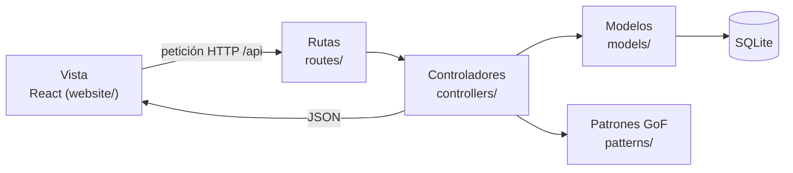

# Nailé · sitio web del salón de uñas

Sitio web con reservas en línea, galería de trabajos con buscador y filtros, diseñador de uñas, tienda y panel para el salón.

- **Frontend:** React + Vite (`website/`)
- **Backend:** Node.js + Express (`api/`)
- **Base de datos:** SQLite (`better-sqlite3`)
- **Fotos:** se suben desde el panel y se guardan en `uploads/`
- **Despliegue:** Railway (un solo servicio entrega la API, las fotos y el sitio)

## Qué tiene

| Página | Ruta | Qué hace |
|---|---|---|
| Inicio | `/` | Portada con foto destacada, servicios, trabajos recientes, pasos para reservar, horario y ubicación |
| Servicios | `/servicios` | Carta de servicios con precio y duración |
| Galería | `/galeria` | Fotos reales con buscador, filtros (servicio, forma, color, acabado), orden y visor a pantalla completa. Los filtros quedan en la URL, así se pueden compartir |
| Diseña tus uñas | `/disena` | Elige forma, largo, color, acabado y decoración, con muestra y recargo en vivo |
| Reservar | `/reservar` | Tres pasos: servicio y especialista, fecha y hora libres, datos y adelanto (SINPE Móvil, tarjeta o en el salón) |
| Tienda | `/tienda` | Productos con buscador, filtros por categoría y precio, orden y carrito |
| Contacto | `/contacto` | Datos, horario, mapa y mensaje directo por WhatsApp |
| Panel | `/admin` | Agenda del día, subir y editar fotos, fotos de productos y pedidos |

## Personalizar para el salón

1. **Datos del local:** `website/src/config.js` (nombre, teléfono, WhatsApp, dirección, horario, redes, SINPE y mapa).
2. **Logo:** el logo actual es provisional. Pon el archivo real en `website/public/logo.svg` (o `.png`) y cambia `website/src/components/Logo.jsx` por ``. Cambia también `website/public/favicon.svg`.
3. **Servicios, especialistas y productos:** `api/src/db/seed.js`. Los precios están en colones y son de ejemplo.
4. **Recargos por diseño:** la tabla `PRECIO` en `api/src/patterns/disenoBuilder.js` y en `website/src/lib/disenoBuilder.js` (deben coincidir).
5. **Fotos:** entra a `/admin`, pestaña Galería, y sube las fotos de los trabajos con su servicio, forma, color y acabado. Así funcionan los filtros. Marca como destacada la que quieras en la portada.

## Correr en local

Necesitas Node.js 20 o superior.

```bash
cd api
npm install
npm run dev          # API en http://localhost:3001

# en otra terminal
cd website
npm install
npm run dev          # sitio en http://localhost:5173
```

La clave del panel en desarrollo es `cambia-esta-clave`. Para cambiarla, define la variable `ADMIN_TOKEN`.

## Desplegar en Railway

1. Sube el proyecto a GitHub.
2. En Railway: **New Project → Deploy from GitHub repo**.
3. En **Settings** del servicio: Build Command `npm run build`, Start Command `npm start`.
4. Agrega un **Volume** montado en `/data`. Ahí viven la base de datos y las fotos; sin el volumen se borran en cada despliegue.
5. En **Variables**:
   - `DB_PATH=/data/naile.db`
   - `UPLOADS_DIR=/data/uploads`
   - `ADMIN_TOKEN=` una clave larga que solo conozca el salón
   - `NODE_ENV=production`
6. **Networking → Generate Domain** para la URL pública. Si el salón tiene dominio propio, se conecta en **Custom Domain**.

## Arquitectura MVC

El proyecto sigue el patrón **Modelo, Vista, Controlador**:

| Capa | Dónde | Responsabilidad |
|---|---|---|
| **Modelo** | `api/src/models/` | Datos y reglas de negocio. Es la única capa que habla con SQLite (por ejemplo, `CitaModel` valida datos, calcula el total y el adelanto y consulta horarios libres). |
| **Vista** | `website/` (React) | Lo que ve la clienta y el salón. No conoce la base de datos: pide todo a la API. |
| **Controlador** | `api/src/controllers/` | Recibe cada petición, pide datos a los modelos, aplica los patrones (cobro, estados, eventos) y responde. |
| Rutas | `api/src/routes/` | Solo conectan cada URL con su controlador, sin lógica. |



Ejemplo, reservar una cita:

1. **Vista:** `website/src/pages/Reservar.jsx` envía `POST /api/citas`.
2. **Ruta:** `routes/publicRoutes.js` la manda a `citaController.crear`.
3. **Controlador:** `controllers/citaController.js` valida con `CitaModel`, cobra con la estrategia de pago (Strategy + Factory), guarda la cita y emite el evento `cita:creada` (Observer).
4. **Modelo:** `models/CitaModel.js` guarda en SQLite; `models/RecordatorioModel.js` guarda los recordatorios.
5. La vista recibe el JSON y muestra la confirmación.

### Estructura del backend

```
api/src/
  index.js        arranque del servidor
  db/             conexión (Singleton), schema.sql y datos iniciales
  models/         Modelo: ServicioModel, EspecialistaModel, FotoModel, ProductoModel,
                  DisenoModel, CitaModel, RecordatorioModel, PedidoModel
  controllers/    Controlador: catalogo, foto, diseno, cita, pedido, productoAdmin
  routes/         publicRoutes.js, adminRoutes.js e index.js
  patterns/       Patrones GoF: pagos (Strategy), estadoCita (State),
                  eventos (Observer), disenoBuilder (Builder)
  middleware/     clave del panel y subida de imágenes
```

## Patrones de diseño (GoF)

| Patrón | Dónde | Para qué |
|---|---|---|
| Singleton | `api/src/db/connection.js` | Una sola conexión a SQLite |
| Strategy | `api/src/patterns/pagos.js` | Tarjeta, SINPE Móvil o pago en el salón con la misma interfaz `cobrar()`; `crearMetodoPago()` elige la estrategia |
| State | `api/src/patterns/estadoCita.js` | Pendiente → confirmada → atendida, o cancelada; bloquea cambios inválidos |
| Observer | `api/src/patterns/eventos.js`, `website/src/context/CarritoContext.jsx` | Recordatorios al crear o cancelar cita; carrito global |
| Builder | `*/disenoBuilder.js` | Armar el diseño paso a paso y calcular el recargo |

## Accesibilidad

- Navegación completa con teclado, foco visible y enlace «Saltar al contenido».
- Filtros, opciones y horarios hechos con casillas y radios reales, que los lectores de pantalla entienden.
- Textos con contraste AA; las fotos usan su descripción como texto alternativo.
- Visor de fotos y carrito con `<dialog>`: Esc cierra y el foco queda dentro.
- Respeta «reducir movimiento» del sistema.

## Pendiente para producción

- Usuarios del panel con contraseña (bcrypt + JWT) en lugar de una sola clave.
- Pasarela de pago real del banco y envío real de recordatorios (WhatsApp Business o correo) leyendo la tabla `recordatorios`.
- Comprimir las fotos al subirlas (por ejemplo con `sharp`).
